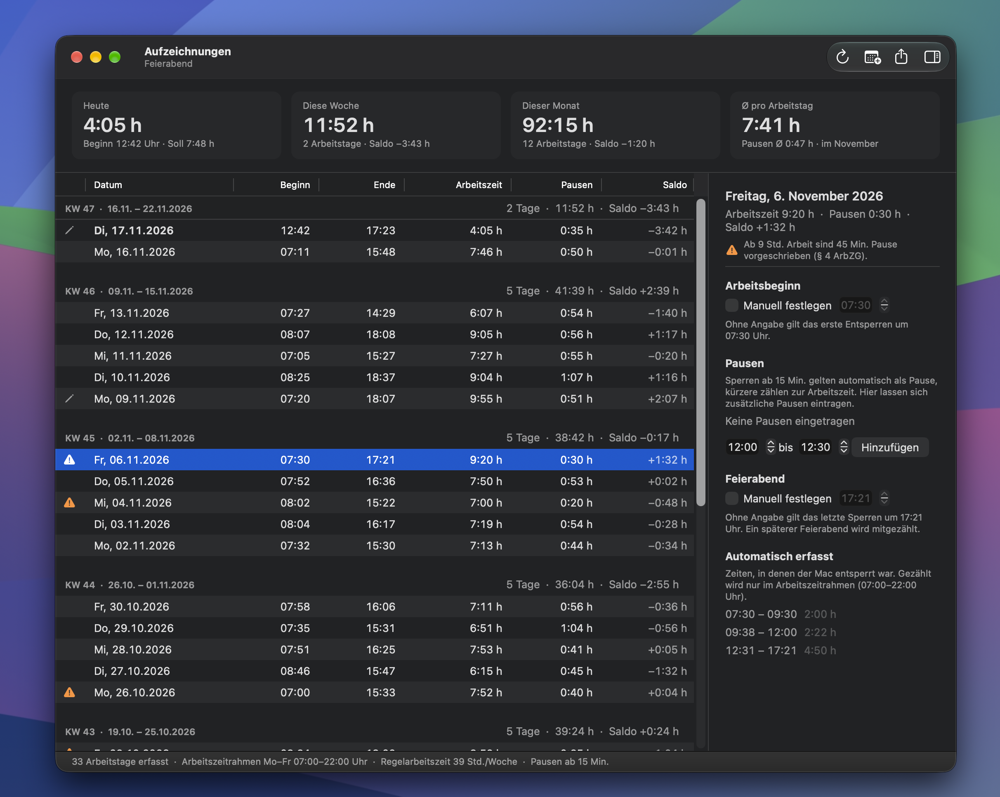
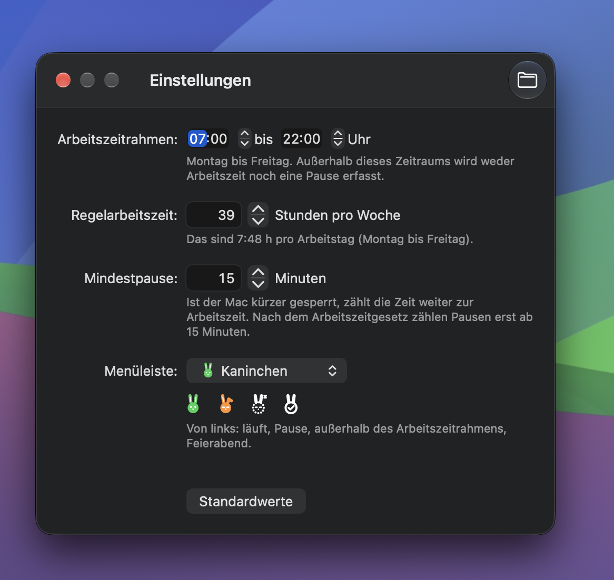
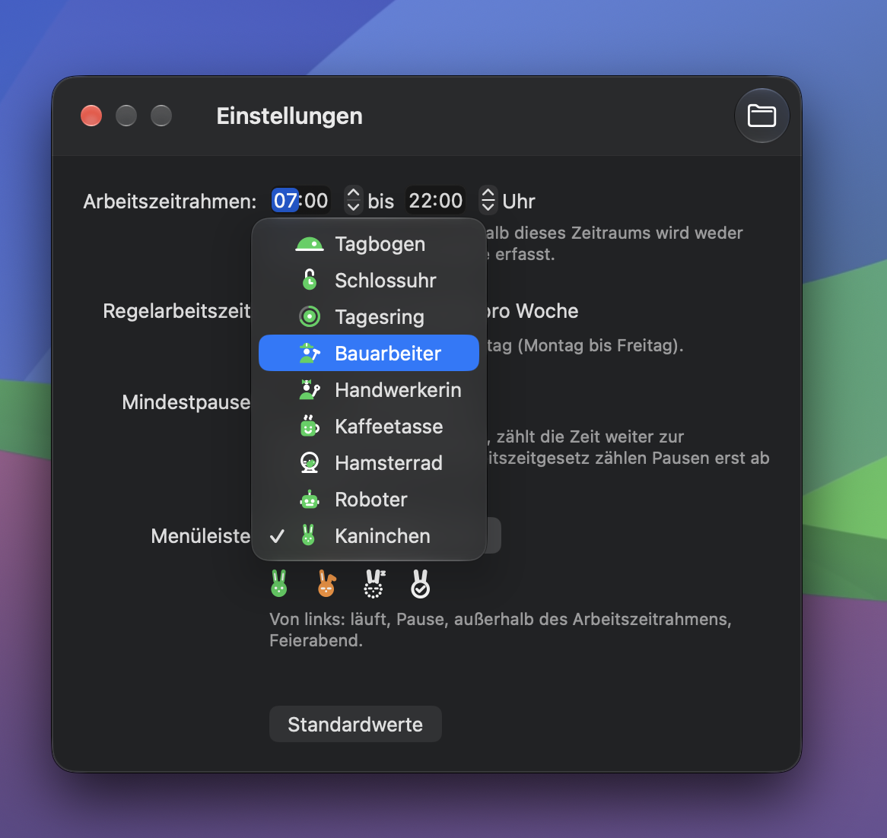

<div align="center">


# Tagwerk

**Automatische Arbeitszeiterfassung in der macOS-Menüleiste.**<br>
Gezählt wird, solange dein Mac entsperrt ist – Pausen, Saldo und Arbeitszeitregeln inklusive.

[](#voraussetzungen)
[](#voraussetzungen)
[](https://www.rust-lang.org)
[](LICENSE)

[Funktionen](#funktionen) ·
[Regeln](#regeln) ·
[Installation](#installation) ·
[Kommandozeile](#kommandozeile) ·
[Daten](#daten) ·
[Entwicklung](#entwicklung)

<br>



</div>

---

## Warum Tagwerk?

Stundenzettel vergisst man – den Sperrbildschirm nicht. Tagwerk läuft unauffällig in
der Menüleiste und erfasst die Zeit, in der der Mac entsperrt ist. Sperrst du den Mac
für mindestens 15 Minuten, ist das eine Pause; kürzere Unterbrechungen zählen weiter
zur Arbeitszeit. Arbeitsbeginn, Pausen und Feierabend lassen sich jederzeit von Hand
festlegen oder korrigieren.

- 🔒 **Kein Starten, kein Stoppen** – Sperren, Entsperren, Ruhezustand und Benutzerwechsel werden automatisch erkannt.
- ⚖️ **Regeln im Blick** – Pausen, Ruhezeit und Höchstarbeitszeit nach Arbeitszeitgesetz werden geprüft.
- 📊 **Soll und Saldo** – je Tag, Woche und Monat, auf Basis deiner Regelwochenarbeitszeit.
- 🗓️ **Wochenansicht** – jede Kalenderwoche übersichtlich wie in einem Kalender, direkt im Fenster „Aufzeichnungen“.
- 🏠 **Lokal und privat** – alle Daten liegen in einer SQLite-Datenbank auf deinem Mac, nichts verlässt das Gerät.
- 🦀 **Nativ** – in Rust geschrieben, mit AppKit-Oberfläche, Hell- und Dunkelmodus.

## Funktionen

### Menüleiste

<table>
  <tr>
    <td align="center"><br><sub><b>Erfassung läuft</b></sub></td>
    <td align="center"><br><sub><b>Pause</b></sub></td>
    <td align="center"><br><sub><b>Feierabend</b></sub></td>
  </tr>
</table>

Das Menü zeigt auf einen Blick den Status, die Arbeitszeit von heute samt Soll, die
Pausen, den Beginn, den Saldo der Woche und Hinweise auf Regelverstöße. Der Status ist
farbig – **grün** = läuft, **orange** = Pause, **indigo** = Feierabend –, der Saldo
grün im Plus und rot im Minus. Diese Zeilen sind reine Anzeige und lassen sich nicht
anklicken.

- **Mitteilungen zur Höchstarbeitszeit** – über die Mitteilungszentrale von macOS kommt
  bei **9:45 Std.** Arbeit eine Vorwarnung („Noch 15 Min. bis 10 Std. Arbeitszeit“) und
  bei **10 Std.** die Meldung „10 Std. Arbeitszeit erreicht“ – jeweils einmal am Tag,
  solange gearbeitet wird (auch ohne Mac). Beim ersten Start fragt macOS, ob Tagwerk
  Mitteilungen senden darf; den Stand zeigen die [Einstellungen](#einstellungen), ändern
  lässt er sich unter Systemeinstellungen › Mitteilungen › Tagwerk. Nur in der
  installierten App.
- **Fehler beim Speichern** – lässt sich die Datenbank nicht schreiben oder lesen, steht
  das rot unter dem Status im Menü und im Tooltip des Symbols, bis es wieder gelingt; beim
  ersten Mal kommt zusätzlich eine Mitteilung. Die Arbeitszeit zählt währenddessen weiter.

- **Pausen ohne Zutun** – jede Sperre ab der eingestellten Mindestdauer (Standard
  15 Minuten) ist eine Pause, egal ob Mittags- oder Kaffeepause. Kürzere Sperren zählen
  zum laufenden Arbeitsblock.
- **Arbeit unterbrechen / Weiter arbeiten** (⌘P bei geöffnetem Menü) – hält die
  Erfassung an, auch wenn der Mac entsperrt bleibt. Wird der Mac währenddessen gesperrt
  oder geht in den Ruhezustand, läuft die Erfassung nach dem Entsperren bzw. Aufwachen
  von selbst weiter. Auch hier gilt die Mindestdauer: Eine kürzere Pause zählt als
  Arbeitszeit. Beim Beenden der App (z. B. für ein Update) bleibt die Pause bestehen,
  beim Abmelden oder Neustarten des Macs endet sie.
- **Ohne Mac weiterarbeiten** – vor einem Meeting, Telefonat oder Termin wählen
  (Meeting, Telefonat, Networking oder Sonstiges). Die Zeit zählt dann als Arbeitszeit, auch wenn
  der Mac gesperrt wird oder in den Ruhezustand geht – bis zum nächsten Entsperren oder
  „Zurück am Mac“, spätestens um Mitternacht oder mit dem Feierabend. Sie erscheint als
  „Arbeit ohne Mac“ mit der gewählten Notiz. Beim Beenden der App bleibt der Zustand
  bestehen, beim Abmelden oder Neustarten endet er.
- **Pause als Arbeitszeit zählen** – nachträglich: das Untermenü listet die Pausen von
  heute; zu jeder Pause wählt man den Grund (Meeting, Telefonat, Networking oder
  Sonstiges), dann ist sie als Arbeit ohne Mac eingetragen.
- **Arbeitsbeginn und Feierabend festlegen** – „jetzt“, „vor N Minuten“ oder zu einer
  frei gewählten Uhrzeit. Korrekturen liegen als eigene Schicht über den erfassten
  Perioden und lassen sich jederzeit zurücknehmen.
- **Über Tagwerk** – Version, Lizenz und Link zum Projekt.

### Aufzeichnungen

Ein natives macOS-Fenster (⌘A bei geöffnetem Menü) mit zwei Ansichten, zwischen denen der
Umschalter **Tage | Woche** in der Symbolleiste wechselt (Menü „Darstellung“, ⌘1 und ⌘2).
Das Fenster öffnet in der zuletzt benutzten Ansicht.

Die Ansicht **Tage** zeigt Kennzahlen für heute, die Woche, den Monat und den
Durchschnitt pro Arbeitstag, eine Tabelle aller Tage mit Saldo und Wochensummen sowie
einen **Inspektor**. Dort lassen sich Arbeitsbeginn, Pausen, Arbeit
ohne Mac und Feierabend eines Tages korrigieren – auch für Tage ohne Aufzeichnung.
**Arbeit ohne Mac** (Telefonat, Meeting … bei gesperrtem Mac) zählt als Arbeitszeit,
mit einem Grund aus der Auswahlbox (Meeting, Telefonat, Networking, Sonstiges); eine
manuelle Pause in dieser Zeit entfällt und umgekehrt. Bleibt dabei eine Lücke kürzer als
die Mindestpause, zählt sie wie eine kurze Sperre mit. Aufeinanderfolgende Einträge bleiben
eigene Abschnitte; ist die Lücke zur benachbarten Arbeitszeit (erfasst oder Arbeit ohne
Mac) kürzer als die Mindestpause, wird sie dem neuen Abschnitt dazugerechnet (mit Hinweis).
Ein Abschnitt dauert mindestens so lange wie in den Einstellungen festgelegt (Standard
15 Min.). Tage mit Regelverstößen tragen ein Warnsymbol, manuell korrigierte Tage einen
Stift.

### Wochenansicht


Die Ansicht **Woche** im Fenster „Aufzeichnungen“ zeigt eine Kalenderwoche wie einen
Kalender: je Tag eine Spalte, jeder Arbeitsabschnitt ein Block von Beginn bis Ende – das
Ergebnis aus automatischer Erfassung und manuellen Korrekturen. Ein Wechsel von „Tage“
zu „Woche“ zeigt die Woche des ausgewählten Tags. In der Menüleisten-App enthält die Woche auch den gerade laufenden Abschnitt.

- Blättern mit ‹ › oder den Pfeiltasten, **Heute** (⌘T) springt zur aktuellen Woche.
- Jeder Tageskopf zeigt Arbeitszeit und Pausen des Tages, die Kopfzeile Arbeitszeit,
  Pausen und Saldo der Woche. Pausen zählen überall nach den angezeigten Uhrzeiten
  (15:25 – 15:45 sind 20 Min.), die Summe eines Tages ist die Summe seiner Pausen.
  Genauso die Arbeitszeit: Ende − Beginn − Pausen ergibt sie genau, und Tage wie Salden
  summieren sich ohne Rundungsreste zur Woche.
- Der Tooltip eines Blocks nennt manuelle Grenzen.
- Ein Klick auf die Uhrzeit von Beginn oder Ende kopiert sie in die Zwischenablage.
- Tage mit Regelverstößen tragen ein Warnschild; ein Klick auf den Tageskopf zeigt die
  Hinweise.
- Arbeit außerhalb des Arbeitszeitrahmens erscheint orange als „nicht gezählt“.
- Arbeit ohne Mac ist schraffiert und, wenn Platz ist, dezent mit der Art beschriftet
  (Meeting, Telefonat …); der Tooltip nennt Uhrzeit und Notiz. Ein Klick auf
  die Schraffur bietet an, sie zu löschen. Danach gilt dort wieder, was erfasst ist: War
  der Mac gesperrt, ist es eine Pause, war er entsperrt, Arbeitszeit. Eine manuelle Pause,
  die die Arbeit ohne Mac beim Eintragen gekürzt hat, kommt nicht zurück.
- Ein Klick auf einen freien Bereich öffnet den Dialog „Arbeit ohne Mac eintragen“ mit
  Beginn, Ende und Grund (Meeting, Telefonat, Networking, Sonstiges). In einer Pause ist
  die ganze Pause vorgeschlagen, vor dem Arbeitsbeginn und nach dem Feierabend eine halbe
  Stunde ab dem Klick. Fährt die Maus über einen freien Bereich, zeigt ein Rahmen genau
  diesen Vorschlag. Zukünftige Zeiten lassen sich nicht eintragen.

<details>
<summary>Weitere Ansichten</summary>
<br>

<br><br>

</details>

### Einstellungen

<table>
  <tr>
    <td align="center"></td>
    <td align="center"></td>
  </tr>
</table>

Erreichbar über „Einstellungen …“ in der Menüleiste oder ⌘, im Fenster „Aufzeichnungen“.
Änderungen gelten sofort, auch für bereits erfasste Tage. Der Ordner-Knopf in der
Titelleiste zeigt den Datenordner im Finder.

| Einstellung           | Bedeutung                                                              | Standard        |
|-----------------------|------------------------------------------------------------------------|-----------------|
| Bei Anmeldung starten | Tagwerk als Anmeldeobjekt eintragen (nur in der installierten App)     | ein             |
| Mitteilungen          | Zeigt, ob Tagwerk Mitteilungen senden darf; wenn nicht, öffnet „Systemeinstellungen öffnen“ die Mitteilungseinstellungen von Tagwerk | – |
| Arbeitszeitrahmen     | Nur in diesem Zeitraum wird Arbeitszeit bzw. Pause gezählt – an jedem Tag | 07:00–22:00 Uhr |
| Regelarbeitszeit      | Wochenarbeitszeit, daraus ergibt sich das Tagessoll                     | 39 Std. (7:48 h/Tag) |
| Mindestpause          | Ab dieser Sperrdauer gilt eine Unterbrechung als Pause                 | 15 Min.         |
| Arbeit ohne Mac       | Mindestdauer beim Eintragen; nie kürzer als die Mindestpause           | 15 Min.         |
| Menüleiste            | Symbolsatz für die Menüleiste, mit Vorschau aller Zustände             | Tagbogen        |

Neun Symbolsätze stehen zur Wahl. Sie werden von der App selbst gezeichnet und sind
damit in jeder Höhe scharf:

- **Tagbogen** – der Arbeitstag als Sonnenbogen, Feierabend als Sonnenuntergang
- **Schlossuhr** – offenes Schloss = Arbeitszeit, geschlossen = Pause
- **Tagesring** – Fortschritt zum Tagessoll
- **Bauarbeiter** und **Handwerkerin** – mit Hammer bzw. Schraubenschlüssel bei der
  Arbeit, mit Kaffee in der Pause, winkend zum Feierabend
- **Kaffeetasse** mit Gesicht, **Hamsterrad**, **Roboter** und **Kaninchen** (in der
  Pause knickt ein Ohr um)

### Export als Markdown

Über „Exportieren …“ im Fenster „Aufzeichnungen“ (Symbolleiste oder Menü „Ablage“, ⌘E)
wird ein frei wählbarer Zeitraum als Markdown-Datei gespeichert – vorbelegt sind die
letzten vier Wochen, „Dieser Monat“ und „Letzter Monat“ sind einen Klick entfernt. Die
Datei enthält:

1. eine **Übersichtstabelle** mit Beginn, Ende, Arbeits- und Pausenzeit (sekundengenau)
   sowie Saldo je Tag und einer Summenzeile,
2. **`## Hinweise`** – Verstöße gegen die [Regeln](#regeln),
3. **`## Korrekturen`** – die manuellen Entscheidungen samt Arbeit ohne Mac mit Notiz,
4. **`## Erfasste Perioden`** – die automatisch erfassten Zeiten.

Ein Export lässt sich mit `Tagwerk --import <datei.md>` wieder einlesen; die enthaltenen
Tage ersetzen dabei die vorhandenen Einträge dieser Tage.

## Regeln

Tagwerk berücksichtigt die folgenden Regeln aus Arbeitszeitgesetz und
Betriebsvereinbarung. Verstöße werden in der Menüleiste, in der Tabelle, im Inspektor,
in der Wochenansicht und im Export angezeigt – die Arbeitszeit selbst wird dadurch nicht
verändert.

| Regel                | Inhalt                                                                  |
|----------------------|-------------------------------------------------------------------------|
| Arbeitszeitrahmen    | Zeit außerhalb des eingestellten Zeitraums wird nicht gezählt; Arbeit am Wochenende zählt ohne Soll als Mehrarbeit und wird gemeldet |
| Sollarbeitszeit      | Regelwochenarbeitszeit / 5 je Arbeitstag (39 Std. → 7:48 Std.)          |
| Pausen (§ 4 ArbZG)   | mehr als 6 Std. Arbeit: 30 Min., mehr als 9 Std.: 45 Min.; höchstens 6 Std. am Stück ohne Pause; es zählen Pausen ab 15 Min. |
| Ruhezeit (§ 5 ArbZG) | mindestens 11 Std. zwischen dem Ende eines Arbeitstags und dem nächsten Beginn |
| Höchstarbeitszeit    | mehr als 10 Std. Arbeit an einem Tag; Mitteilung bei 9:45 und 10 Std.   |
| Erfassung            | Beginn und Ende durch Entsperren/Sperren, Arbeit unterbrechen/Weiter arbeiten oder Ohne Mac weiterarbeiten; keine Einträge in der Zukunft |

> [!NOTE]
> Der Saldo vergleicht die Arbeitszeit mit dem Soll – aber nur für Tage, an denen
> gearbeitet wurde. Urlaub, Feiertage oder Krankheit drücken den Saldo also nicht;
> Arbeit am Wochenende zählt vollständig als Mehrarbeit.

## Installation

### Voraussetzungen

- macOS 13 (Ventura) oder neuer, Apple Silicon (arm64)
- Zum Bauen: [Rust](https://rustup.rs) und die Xcode-Befehlszeilenwerkzeuge
  (`xcode-select --install`)

### Aus dem Quellcode bauen

```bash
git clone https://github.com/rfoerthe/tagwerk.git
cd tagwerk
./build.sh --no-sign --install
```

Damit wird Tagwerk gebaut, ad hoc signiert und nach `/Applications` kopiert. Zum
schnellen Ausprobieren während der Entwicklung genügt `cargo run`.

### App-Bundle und DMG

`build.sh` erzeugt ein fertiges App-Bundle samt DMG:

```bash
./build.sh                 # sauber bauen, signieren und notarisieren
./build.sh --no-notarize   # nur bauen und signieren
./build.sh --no-sign       # nur bauen (ad-hoc signiert, nur für diesen Mac)
./build.sh --install       # zusätzlich nach /Applications installieren
```

`--install` lässt sich mit den anderen Optionen kombinieren. Läuft Tagwerk bereits aus
`/Applications`, wird es vorher regulär beendet – die laufende Erfassung wird dabei
gespeichert – und nach dem Kopieren wieder gestartet.

Das Ergebnis liegt in `target/dist/Tagwerk-<Version>.dmg`. Das Skript führt vorher
`cargo clean` aus; ältere DMGs in `target/dist` werden dabei gelöscht.

<details>
<summary>Signieren und Notarisieren</summary>
<br>

| Variable         | Bedeutung                                   | Standard                       |
|------------------|---------------------------------------------|--------------------------------|
| `SIGN_IDENTITY`  | Zertifikat „Developer ID Application: …“    | erste gefundene Developer-ID   |
| `NOTARY_PROFILE` | Schlüsselbund-Profil für `notarytool`       | `general-notary`               |
| `BUNDLE_ID`      | Bundle-Kennung                              | `de.foerther.tagwerk`          |

`build.sh` notarisiert zuerst die App und heftet ihr das Ticket an, damit sie nach dem
Kopieren auch ohne Internetverbindung startet. Danach packt es die App ins DMG und
notarisiert auch das DMG – pro Build gibt es also zwei Einreichungen bei Apple. Beide
müssen Gatekeeper als „Notarized Developer ID“ bestehen, sonst bricht das Skript ab.

Das Notary-Profil wird einmalig angelegt mit:

```bash
xcrun notarytool store-credentials general-notary --apple-id <apple-id> --team-id <team-id>
```

</details>

### Release auf GitHub

Nach `./build.sh` veröffentlicht `github-release.sh` das DMG als Release auf GitHub:

```bash
./github-release.sh --dry-run   # nur prüfen und anzeigen, was passieren würde
./github-release.sh             # Tag v<Version> setzen und Release veröffentlichen
```

Das Skript prüft Prüfsumme (`Tagwerk-<Version>.dmg.sha256` von `build.sh`), Signatur und
Notarisierung, gleicht die Version mit `Cargo.toml` ab und übernimmt die Release-Notizen
aus dem passenden Eintrag in [CHANGELOG.md](CHANGELOG.md). Voraussetzung ist die
[GitHub CLI](https://cli.github.com) (`brew install gh`, `gh auth login`); der Commit
muss bereits gepusht sein.

## Kommandozeile

```text
Tagwerk                       Menüleisten-App (Standard)
Tagwerk --records             nur das Fenster „Aufzeichnungen“ öffnen
Tagwerk --export [--from TT.MM.JJJJ] [--to TT.MM.JJJJ] [-o datei.md]
                              Aufzeichnungen als Markdown exportieren
                              (Standard: die letzten 28 Tage, Ausgabe auf stdout)
Tagwerk --import <datei.md>   Tage aus einem Markdown-Export übernehmen
Tagwerk --screenshot <png>    Fenster „Aufzeichnungen“ als Bild speichern und beenden
Tagwerk --week-screenshot <png>
                              Fenster „Aufzeichnungen“ in der Ansicht „Woche“ als Bild
                              speichern und beenden
Tagwerk --settings-screenshot <png>
                              Fenster „Einstellungen“ als Bild speichern und beenden
```

Es läuft immer nur eine Instanz der Menüleisten-App.

## Daten

Alle Daten liegen lokal in einer SQLite-Datenbank:

```text
~/Library/Application Support/Tagwerk/tagwerk.db
```

Sie enthält die automatisch erfassten Perioden (Mac entsperrt), getrennt davon die
manuellen Korrekturen (Arbeitsbeginn, Pausen, Arbeit ohne Mac, Feierabend) sowie die Einstellungen. Die
Perioden werden ungekürzt gespeichert; Mindestpause und Arbeitszeitrahmen wirken erst
bei der Berechnung. Bearbeitet werden die Daten im Fenster „Aufzeichnungen“; Änderungen
dort übernimmt die laufende App automatisch.

**Backups:** Vor der ersten Änderung eines Tages wird die Datenbank unter
`backups/tagwerk-JJJJ-MM-TT.db` gesichert; die letzten 15 Backups bleiben erhalten.

**Ältere Versionen:** Die Markdown-Datei `tagwerk.md` früherer Versionen wird beim
ersten Start einmalig in die Datenbank übernommen und danach in `tagwerk.md.importiert`
umbenannt. Ab Version 1.2.0 nutzt die Datenbank Schema 3; Tagwerk 1.1 und älter können
sie danach nicht mehr öffnen – zurück geht es nur mit einem Backup aus `backups/` von
einem Tag vor dem Update.

## Entwicklung

```bash
cargo run     # App starten
cargo test    # Tests ausführen
```

Zum Testen lässt sich der Datenordner mit der Umgebungsvariablen `TAGWERK_DIR`
umlenken:

```bash
TAGWERK_DIR=/tmp/tagwerk-test cargo run
```

Das App-Symbol liegt als `assets/AppIcon.png` (1024 × 1024) im Projekt, die Vorlage
dazu als `assets/AppIcon.svg`; `build.sh` erzeugt daraus `AppIcon.icns`. Die Symbole der
Menüleiste zeichnet die App selbst (`src/glyphs.rs`).

<details>
<summary>Testdaten</summary>
<br>

`testdata/testdb.sh` erzeugt eine Testdatenbank, die immer bis gestern reicht: sechs
volle Wochen plus die Tage der laufenden Woche, Wochensummen um 39 Stunden ± 10 %,
bundesweite Feiertage frei. An rund 25 % der Tage gibt es Arbeit ohne Mac (Meeting,
Telefonat, Networking, Sonstiges – bei gesperrtem Mac, vor dem Beginn oder nach dem Ende,
einmal auch Meeting und Telefonat direkt hintereinander als zwei Abschnitte), dazu
einige Regelverstöße: zu kurze Ruhezeit, Arbeit vor 7 und nach 22 Uhr, zu wenig Pause.
Datenbank und Markdown-Quelle landen in `target/testdata/` und werden bei jedem Aufruf
neu erzeugt.

```bash
testdata/testdb.sh             # target/testdata/tagwerk.db neu bauen
testdata/testdb.sh --install   # zusätzlich als zentrale Datenbank einsetzen
testdata/testdb.sh --restore   # die echten Daten zurückholen
```

Mit `--install` wird die zentrale Datenbank vorher nach
`~/Library/Application Support/Tagwerk/vor-testdaten/` gesichert – außer sie enthält
schon Testdaten (die Testdatenbank ist dafür gekennzeichnet). `--restore` holt die
neueste Sicherung mit echten Daten zurück. Laufende Tagwerk-Instanzen werden dafür
beendet und – wenn sie als App liefen – danach neu gestartet. Ohne Austausch lässt sich
die Testdatenbank auch direkt öffnen:

```bash
TAGWERK_DIR=target/testdata cargo run -- --records
```

</details>

## Lizenz

Tagwerk steht unter der [MIT-Lizenz](LICENSE).
