<div align="center">

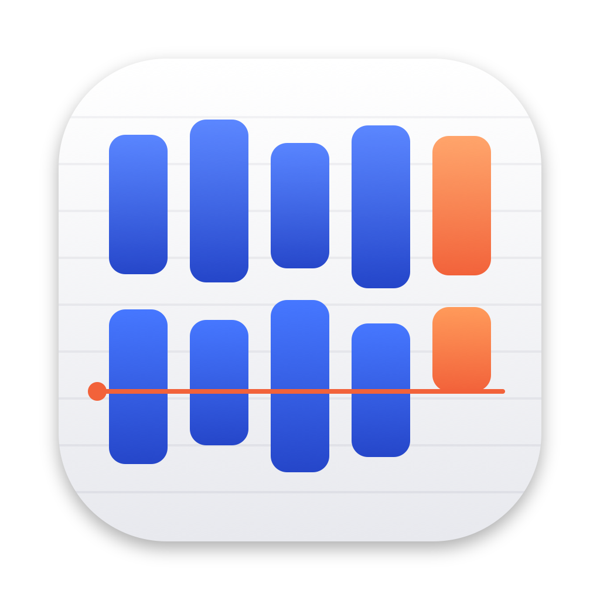

# Tagwerk

**Automatische Arbeitszeiterfassung in der macOS-Menüleiste.**<br>
Gezählt wird, solange dein Mac entsperrt ist – Pausen, Saldo und Arbeitszeitregeln inklusive.

[](#voraussetzungen)
[](#voraussetzungen)
[](https://www.rust-lang.org)
[](LICENSE)

[Funktionen](#funktionen) ·
[Regeln](#regeln) ·
[Installation](#installation) ·
[Kommandozeile](#kommandozeile) ·
[Daten](#daten) ·
[Entwicklung](#entwicklung)

<br>


</div>

---

## Warum Tagwerk?

Stundenzettel vergisst man – den Sperrbildschirm nicht. Tagwerk läuft unauffällig in
der Menüleiste und erfasst die Zeit, in der der Mac entsperrt ist. Sperrst du den Mac
für mindestens 15 Minuten, ist das eine Pause; kürzere Unterbrechungen zählen weiter
zur Arbeitszeit. Arbeitsbeginn, Pausen und Feierabend lassen sich jederzeit von Hand
festlegen oder korrigieren.

- 🔒 **Kein Starten, kein Stoppen** – Sperren, Entsperren, Ruhezustand und Benutzerwechsel werden automatisch erkannt.
- ⚖️ **Regeln im Blick** – Pausen, Ruhezeit und Höchstarbeitszeit nach [Arbeitszeitgesetz](https://www.gesetze-im-internet.de/arbzg/BJNR117100994.html) werden geprüft.
- 📊 **Soll, Saldo und Zeitkonto** – je Tag, Woche und Monat, auf Basis deiner Regelwochenarbeitszeit und deiner Arbeitstage; das Zeitkonto zählt fortlaufend.
- 🗓️ **Wochenansicht** – jede Kalenderwoche übersichtlich wie in einem Kalender, direkt im Fenster „Aufzeichnungen“.
- 🏠 **Lokal und privat** – Datenbank und tägliche Backups liegen nur in deinem Benutzerordner auf dem Mac; kein Konto, keine Cloud, nichts verlässt das Gerät. [Mehr unter „Daten“](#daten)
- 🔐 **Auf Wunsch verschlüsselt** – Datenbank und Backups lassen sich mit einem Haken in den Einstellungen verschlüsseln (AES-256, Schlüssel im Schlüsselbund).
- 🦀 **Nativ** – in Rust geschrieben, mit AppKit-Oberfläche, Hell- und Dunkelmodus.

## Funktionen

### Menüleiste

<table>
  <tr>
    <td align="center">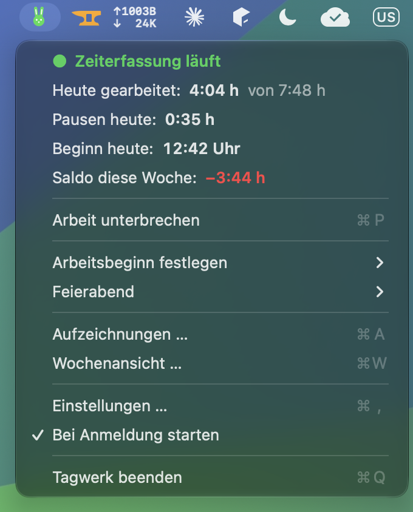<br><sub><b>Erfassung läuft</b></sub></td>
    <td align="center">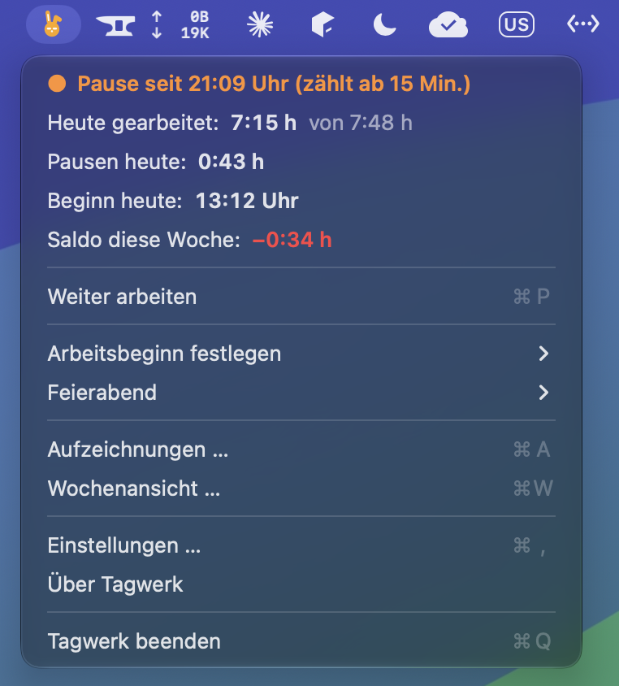<br><sub><b>Pause</b></sub></td>
  </tr>
  <tr>
    <td align="center">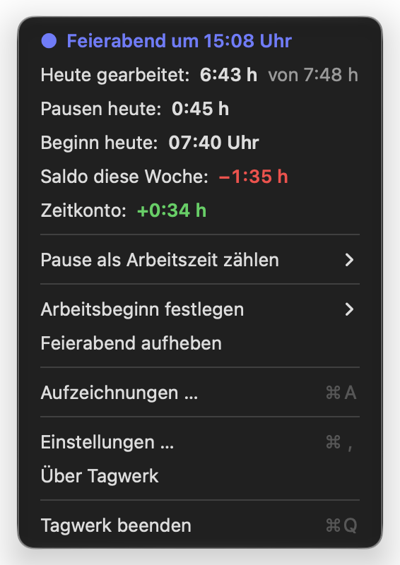<br><sub><b>Feierabend</b></sub></td>
    <td align="center">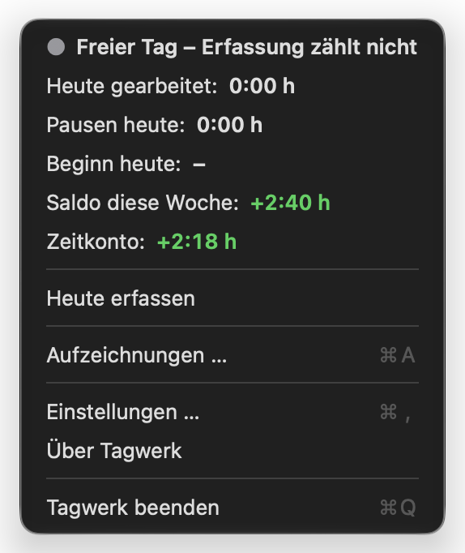<br><sub><b>Freier Tag</b></sub></td>
  </tr>
</table>

Das Menü zeigt auf einen Blick den Status, die Arbeitszeit von heute samt Soll, die
Pausen, den Beginn, den Saldo der Woche, das Zeitkonto und Hinweise auf Regelverstöße.
Der Status ist farbig – **grün** = läuft, **orange** = Pause, **indigo** = Feierabend,
**grau** = außerhalb des Arbeitszeitrahmens oder freier Tag –, Saldo und Zeitkonto sind
grün im Plus und rot im Minus, hier wie im Fenster „Aufzeichnungen“. An einem freien Tag
bietet das Menü zunächst nur **Heute erfassen** an (siehe unten). Diese Zeilen sind
reine Anzeige und lassen sich nicht anklicken. Lange Hinweise brechen um, damit das Menü schmal bleibt.

- **Mitteilungen zu Pause und Höchstarbeitszeit** – über die Mitteilungszentrale von macOS:
  bei **5:45** und **6 Std.** Arbeit am Stück die Erinnerung an die Pause („Noch 15 Min.
  bis 6 Std. ohne Pause“), bei **9:45** und **10 Std.** Arbeit am Tag die an die
  Höchstarbeitszeit. Jede Schwelle wird einmal gemeldet, solange gearbeitet wird (auch
  ohne Mac); nach einer Pause von mindestens 15 Min. beginnt die Arbeit am Stück neu.
  Beide Erinnerungen lassen sich in den [Einstellungen](#einstellungen) abschalten. Beim
  ersten Start fragt macOS, ob Tagwerk Mitteilungen senden darf; ändern lässt sich das
  unter Systemeinstellungen › Mitteilungen › Tagwerk. Nur in der installierten App.
- **Inaktivität** (einschaltbar) – bleibt der entsperrte Mac länger als eingestellt ohne
  Eingabe, gilt er als verlassen: Die Erfassung endet rückwirkend mit der letzten Eingabe,
  wie bei einer Sperre, und läuft mit der nächsten Eingabe weiter – auch am nächsten
  Morgen, wenn der Mac über Nacht nie gesperrt war. Solange eine App den Bildschirm wach
  hält (Videokonferenz, Präsentation), zählt die Zeit weiter.
- **Nachfrage nach langer Sperre** (einschaltbar) – war der Mac mindestens 30 Min.
  gesperrt (bei einer längeren Mindestpause: so lange wie sie), fragt beim Entsperren eine
  Mitteilung, was die Zeit war: Meeting, Telefonat,
  Networking oder sonstige Arbeit ohne Mac – oder schon Feierabend (dann endet der Tag mit
  dem Sperren). Ohne Antwort bleibt es eine Pause.
- **Zeitkonto** – das Menü zeigt neben dem Saldo der Woche den Stand des Zeitkontos: den
  Saldo aller erfassten Tage, auf Wunsch erst ab einem Datum und mit einem Übertrag.
- **Fehler beim Speichern** – lässt sich die Datenbank nicht schreiben oder lesen, steht
  das rot unter dem Status im Menü und im Tooltip des Symbols, bis es wieder gelingt; beim
  ersten Mal kommt zusätzlich eine Mitteilung. Die Arbeitszeit zählt währenddessen weiter.

- **Pausen ohne Zutun** – jede Sperre ab der eingestellten Mindestdauer (Standard
  15 Minuten) ist eine Pause, egal ob Mittags- oder Kaffeepause. Kürzere Sperren zählen
  zum laufenden Arbeitsblock.
- **Arbeit unterbrechen / Weiter arbeiten** (⌘P bei geöffnetem Menü) – hält die
  Erfassung an, auch wenn der Mac entsperrt bleibt. Wird der Mac währenddessen gesperrt
  oder geht in den Ruhezustand, läuft die Erfassung nach dem Entsperren bzw. Aufwachen
  von selbst weiter. Auch hier gilt die Mindestdauer: Eine kürzere Pause zählt als
  Arbeitszeit. Beim Beenden der App (z. B. für ein Update) bleibt die Pause bestehen,
  beim Abmelden oder Neustarten des Macs endet sie.
- **Ohne Mac weiterarbeiten** – vor einem Meeting, Telefonat oder Termin wählen
  (Meeting, Telefonat, Networking oder Sonstiges). Die Zeit zählt dann als Arbeitszeit, auch wenn
  der Mac gesperrt wird oder in den Ruhezustand geht – bis zum nächsten Entsperren oder
  „Zurück am Mac“, spätestens mit dem Feierabend. Sie erscheint als „Arbeit ohne Mac“ mit
  der gewählten Notiz. Wählt bis Mitternacht niemand „Zurück am Mac“, war es vergessen:
  Dann endet die Arbeit ohne Mac mit dem Arbeitszeitrahmen, und beim nächsten Entsperren
  nennt eine Mitteilung den Eintrag – das wahre Ende trägt man im Fenster „Aufzeichnungen“
  nach. Beim Beenden der App bleibt der Zustand
  bestehen, beim Abmelden oder Neustarten endet er.
- **Heute erfassen** – nur an freien Tagen (Wochenende, abgewählte Arbeitstage), nicht
  nach Feierabend. Dort zeichnet Tagwerk zwar auf, zählt aber nichts: Der Status heißt
  „Freier Tag – Erfassung zählt nicht“, das Symbol ist das für „außerhalb“, und das Menü
  bietet nur „Heute erfassen“ an – Arbeitsbeginn, Arbeit unterbrechen, Ohne Mac
  weiterarbeiten, Pause als Arbeitszeit zählen und Feierabend erscheinen erst danach. Mit „Heute erfassen“ zählt die
  Zeit des Tages – rückwirkend ab dem ersten Entsperren; ein Häkchen zeigt das, ein
  zweiter Klick nimmt es zurück. Löscht man im Fenster „Aufzeichnungen“ alle Einträge des
  Tages, fällt auch der Haken weg, und die Erfassung bleibt für heute aus („Freier Tag –
  Erfassung aus“), bis „Heute erfassen“ wieder gewählt ist. Abschaltbar in den
  Einstellungen („Freie Tage“).
- **Pause als Arbeitszeit zählen** – nachträglich: das Untermenü listet die Pausen von
  heute; zu jeder Pause wählt man den Grund (Meeting, Telefonat, Networking oder
  Sonstiges), dann ist sie als Arbeit ohne Mac eingetragen.
- **Arbeitsbeginn und Feierabend festlegen** – „jetzt“, „vor N Minuten“ oder zu einer
  frei gewählten Uhrzeit. Korrekturen liegen als eigene Schicht über den erfassten
  Perioden und lassen sich jederzeit zurücknehmen. Für Arbeit ohne Mac gilt dabei die
  letzte Angabe: Liegt ein Termin vor dem neu festgelegten Beginn oder nach dem neu
  festgelegten Feierabend, entfällt er bzw. wird dort abgeschnitten – eine Mitteilung
  nennt, was entfallen ist. Wird der Termin erst danach eingetragen, zählt er auch vor dem
  Beginn bzw. nach dem Feierabend. Der Beginn muss vor dem Feierabend liegen; sonst bleibt
  alles, wie es war, und eine Mitteilung sagt, warum. Nach dem Feierabend zeichnet Tagwerk
  weiter auf, zählt aber nichts mehr: Wer ihn mit „Feierabend aufheben“ zurücknimmt,
  bekommt die Zeit dazwischen zurück. Während „Arbeit unterbrechen“ endet der Tag mit der
  Unterbrechung, nicht erst mit dem Klick. Vor Beginn des Arbeitszeitrahmens gibt es
  keinen Feierabend – kurz nach Mitternacht ist der Abend davor gemeint, und der neue Tag
  bliebe sonst gesperrt.
- **Arbeitszeit neben dem Symbol** – auf Wunsch steht die Arbeitszeit von heute (z. B.
  `6:12`) rechts neben dem Symbol in der Menüleiste; sonst zeigt sie der Tooltip.
- **Globale Kurzbefehle** – auf Wunsch wirken ⌃⌥⌘P („Arbeit unterbrechen“ bzw. „Weiter
  arbeiten“) und ⌃⌥⌘A („Aufzeichnungen“) in jeder App, auch bei geschlossenem Menü. Beides
  wird in den [Einstellungen](#einstellungen) eingeschaltet.
- **Über Tagwerk** – Version, Lizenz und Link zum Projekt.

### Aufzeichnungen

Ein natives macOS-Fenster (⌘A bei geöffnetem Menü) mit zwei Ansichten, zwischen denen der
Umschalter **Tage | Woche** in der Symbolleiste wechselt (Menü „Darstellung“, ⌘1 und ⌘2).
Aus der Liste in „Tage“ springt ein Doppelklick auf eine Zeile oder ein Rechtsklick („In der
Wochenansicht zeigen“) in die Woche dieses Tags – auf einer Wochenzeile in diese Woche.
Das Fenster öffnet in der zuletzt benutzten Ansicht.

Die Ansicht **Tage** zeigt Kennzahlen für heute, die Woche, den Monat, den
Durchschnitt pro Arbeitstag und das Zeitkonto, eine Tabelle aller Tage mit Saldo und Wochensummen sowie
einen **Inspektor**. Dort lassen sich Arbeitsbeginn, Pausen, Arbeit
ohne Mac und Feierabend eines Tages korrigieren – auch für Tage ohne Aufzeichnung. Der
Arbeitsbeginn muss vor dem Feierabend liegen, und Zeiten in der Zukunft gibt es nicht: An
künftigen Tagen lässt sich nur eine Abwesenheit eintragen, heute nichts nach der jetzigen
Uhrzeit. Was nicht geht, sagt der Inspektor über dem betroffenen Feld; der Tag bleibt dann,
wie er ist. Liegt ein neuer Eintrag vor dem bisher ersten erfassten Tag, fragt ein Dialog
nach – alle Arbeitstage dazwischen zählten sonst unbemerkt mit ihrem Soll als Minus.
**Arbeit ohne Mac** (Telefonat, Meeting … bei gesperrtem Mac) zählt als Arbeitszeit,
mit einem Grund aus der Auswahlbox (Meeting, Telefonat, Networking, Sonstiges); eine
manuelle Pause in dieser Zeit entfällt und umgekehrt. Genauso bei Arbeitsbeginn und
Feierabend: Wer sie festlegt, kürzt Arbeit ohne Mac davor bzw. danach (der Inspektor weist
darauf hin, ⌘Z nimmt es zurück); wer die Arbeit ohne Mac danach einträgt, lässt sie zählen. Bleibt dabei eine Lücke kürzer als
die Mindestpause, zählt sie wie eine kurze Sperre mit. Aufeinanderfolgende Einträge bleiben
eigene Abschnitte; ist die Lücke zur benachbarten Arbeitszeit (erfasst oder Arbeit ohne
Mac) kürzer als die Mindestpause, wird sie dem neuen Abschnitt dazugerechnet (mit Hinweis).
Ein Abschnitt dauert mindestens so lange wie in den Einstellungen festgelegt (Standard
15 Min.). Tage mit Regelverstößen tragen ein Warnsymbol, manuell korrigierte Tage einen
Stift – trifft beides zu, stehen beide Symbole nebeneinander. Vergangene Arbeitstage ganz
ohne Eintrag stehen mit einem Fragezeichen in der Liste: 0:00 h Arbeitszeit und ihr Soll
als Minus, bis Zeiten oder eine Abwesenheit nachgetragen sind.

Salden sind überall farbig, grün im Plus und rot im Minus: in der Spalte „Saldo“, in den
Wochensummen, in den Kennzahlen samt Zeitkonto und im Kopf der Wochenansicht. Der Inspektor
nennt oben Arbeitszeit, Pausen und Saldo des Tages als drei Zahlen nebeneinander. Was ein
Abschnitt bewirkt, erklärt der Info-Knopf (ⓘ) neben seiner Überschrift – als Tooltip und
auf Klick als kleines Fenster. Der Abschnitt „Automatisch erfasst“ ganz unten ist
zugeklappt und nennt dann nur Anzahl und Spanne der Zeiten, in denen der Mac entsperrt war
(„5 Zeiten, 07:28 – 18:01“); das Dreieck vor der Überschrift klappt die einzelnen Zeiten
auf. Tagwerk merkt sich das für alle Tage.

- **Abwesenheit** – im Inspektor lässt sich für einen Tag Urlaub, Sonderurlaub, Krank,
  Feiertag oder Zeitausgleich eintragen, auch für Tage ohne Aufzeichnung (über „Tag bearbeiten“), in der
  Wochenansicht per Rechtsklick – dort auch im Voraus. Ganztags geht das nur an einem Tag
  ohne andere Einträge (erfasste Zeiten, Arbeitsbeginn, Feierabend, Pausen, Arbeit ohne
  Mac): Die löscht man vorher selbst mit „Alle Einträge löschen …“. Heute zählen dabei nur
  die Einträge von Hand – die automatisch erfasste Zeit entfällt nach einer Rückfrage mit
  der Abwesenheit, und die Erfassung endet für heute (⌘Z nimmt das zurück). Umgekehrt sperrt eine
  ganztägige Abwesenheit den Tag: Im Inspektor und in der Wochenansicht lässt sich dann
  nichts anderes eintragen oder ändern, bis sie wieder auf „Keine“ steht, und die
  Menüleisten-App erfasst an diesem Tag nichts: Das Menü zeigt „Heute abwesend: Urlaub“
  ohne Arbeitsbeginn, Unterbrechen, Ohne Mac und Feierabend. Ein halber Tag geht auch neben
  Arbeitszeit: „Ganzer Tag/Halber Tag“ lässt sich schon vor der Art wählen, und die
  Rückfrage für heute bietet „Halben Tag eintragen“ an – die erfasste Zeit bleibt dann. An
  freien Tagen (Wochenende, abgewählte Arbeitstage) gibt es kein Soll; dort lässt sich
  keine Abwesenheit eintragen, eine vorhandene nur entfernen. Urlaub,
  Krankheit und Feiertag senken das Soll des Tages – ganz oder, als halber Tag, auf die
  Hälfte: Ein halber Urlaubstag mit vier Stunden Arbeit ist damit kein Minus mehr.
  Sonderurlaub (etwa für Hochzeit, Umzug oder Todesfall) senkt das Soll ebenfalls, gilt
  aber immer für den ganzen Tag. Zeitausgleich lässt das Soll stehen, auch ganz ohne
  Arbeitszeit – so sinkt das Zeitkonto um den freien Tag. In der Tabelle steht hinter dem
  Datum ein Kürzel (U, SU, K, F, ZA, halbe Tage mit ½), in der Wochenansicht die
  Abwesenheit im Tageskopf.

- **Erfassung** – an einem freien Tag, an dem Tagwerk aufgezeichnet hat, steht unter der
  Abwesenheit der Haken „Erfasste Zeit zählen“ – derselbe wie „Heute erfassen“ im Menü und
  „Erfasste Zeit zählen“ in der Wochenansicht. Ohne Haken zählt die erfasste Zeit nicht:
  Oben steht „Freier Tag – die erfasste Zeit zählt nicht“, die Tabelle zeigt weder Beginn
  noch Ende, und Arbeitsbeginn, Pausen und Feierabend lassen sich erst mit dem Haken
  festlegen (schon festgelegte lassen sich entfernen; solange der Haken fehlt, gelten
  Beginn und Feierabend nicht). Arbeit ohne Mac geht immer – wie in
  der Wochenansicht, die an einem solchen Tag auch keine Kanten zum Verschieben zeigt.

- **Alle Einträge löschen** – ganz unten im Inspektor oder per Rechtsklick in der
  Wochenansicht leert „Alle Einträge löschen …“ einen Tag: die automatisch erfassten Zeiten ebenso wie Arbeitsbeginn, Feierabend, Pausen, Arbeit
  ohne Mac und Abwesenheit. Vorher fragt ein Dialog nach und nennt, was wegfällt; ⌘Z holt
  den Tag vollständig zurück. Für heute läuft die automatische Erfassung danach ab dem
  Löschen weiter. Der Befehl erscheint nur, wenn der Tag mehr als eine Abwesenheit hat –
  die allein entfernt „Abwesenheit → Keine“.

- **Widerrufen und Wiederholen** (⌘Z, ⇧⌘Z, Menü „Bearbeiten“) – jede Korrektur aus dem
  Inspektor und der Wochenansicht lässt sich zurücknehmen, bis zu 50 Schritte, solange das
  Fenster offen ist. Das Menü nennt den Schritt („Widerrufen: Pause entfernen“), und der
  betroffene Tag wird gezeigt. Zurückgenommen wird nur, was der Schritt selbst geändert
  hat: Was inzwischen anders geändert wurde – etwa ein Feierabend oder „Ohne Mac
  weiterarbeiten“ aus dem Menü –, bleibt, und eine Meldung nennt es. Ergäbe das Widerrufen
  einen unzulässigen Tag (Beginn nicht vor Feierabend, ganztägige Abwesenheit neben
  Einträgen), bleibt der Tag, wie er ist. Inzwischen erfasste Zeit bleibt immer – auch nach
  „Alle Einträge löschen“, das die gelöschte erfasste Zeit zurückbringt.
- **Filter** (Symbolleiste oder Menü „Darstellung“) – schränkt die Tabelle auf einen Zeitraum
  ein (dieser oder letzter Monat, dieses oder letztes Jahr), auf Tage mit Hinweisen oder auf
  korrigierte Tage; die Merkmale lassen sich kombinieren. Solange gefiltert wird, ist das
  Symbol gefüllt, und die Fußzeile nennt, wie viele Tage zu sehen sind. Kennzahlen und
  Wochensummen zählen weiter alles. „Arbeitstage“ sind überall die Tage mit Arbeitszeit –
  in den Kennzahlen, den Wochenzeilen, der Fußzeile, im Export-Dialog und in den
  Summenzeilen der Exporte.

### Wochenansicht

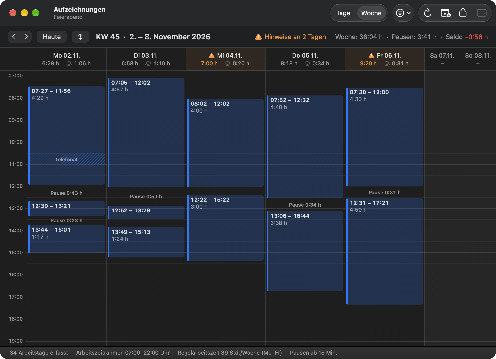

Die Ansicht **Woche** im Fenster „Aufzeichnungen“ zeigt eine Kalenderwoche wie einen
Kalender: je Tag eine Spalte, jeder Arbeitsabschnitt ein Block von Beginn bis Ende – das
Ergebnis aus automatischer Erfassung und manuellen Korrekturen. Ein Wechsel von „Tage“
zu „Woche“ zeigt die Woche des ausgewählten Tags. In der Menüleisten-App enthält die Woche auch den gerade laufenden Abschnitt.

- Blättern mit ‹ › oder den Pfeiltasten, **Heute** (⌘T) springt zur aktuellen Woche.
- Das Raster zeigt nur, was die Woche braucht: die Stunden, in denen gearbeitet wurde, mit
  einer Stunde Luft davor und danach (mindestens neun Stunden, in der laufenden Woche bis
  zur aktuellen Uhrzeit), und freie Tage ohne Eintrag als schmale Spalten. Der Knopf mit
  dem Doppelpfeil neben „Heute“ schaltet auf den ganzen Arbeitszeitrahmen um; die Wahl
  bleibt gespeichert. Arbeit außerhalb des Rahmens ist in beiden Fällen zu sehen.
- Jeder Tageskopf zeigt Arbeitszeit und Pausen des Tages, die Kopfzeile Arbeitszeit,
  Pausen und Saldo der Woche. Pausen zählen überall nach den angezeigten Uhrzeiten
  (15:25 – 15:45 sind 20 Min.), die Summe eines Tages ist die Summe seiner Pausen.
  Genauso die Arbeitszeit: Ende − Beginn − Pausen ergibt sie genau, und Tage wie Salden
  summieren sich ohne Rundungsreste zur Woche.
- Der Tooltip eines Blocks nennt manuelle Grenzen.
- Ein Klick auf die Uhrzeit von Beginn oder Ende kopiert sie in die Zwischenablage.
- Ein Doppelklick auf einen Tageskopf oder einen Abschnitt öffnet den Tag in der Ansicht
  „Tage“ mit dem Inspektor – für Pausen, Arbeitsbeginn und Feierabend.
- Arbeitsbeginn und Feierabend lassen sich mit der Maus verschieben: Fährt die Maus an die
  Oberkante des ersten bzw. die Unterkante des letzten Abschnitts, erscheint ein Griff.
  Beim Ziehen folgt der Tag samt Arbeitszeit und Pausen im Tageskopf, ein Schild nennt die
  neue Uhrzeit und die Abweichung („Beginn 07:30 · +25 Min.“). Ändert sich die Arbeitszeit
  dabei anders als die Uhrzeit, steht es dazu („· Arbeitszeit +1:45 h“) – etwa wenn ein
  manueller Feierabend neben abgesetzter Arbeit ohne Mac die Zeit seit dem letzten Sperren
  mitzählen lässt. Die Zeit rastet auf 5 Minuten ein, mit gedrückter ⌥-Taste auf die
  Minute, und am erfassten Wert – dorthin zurückgezogen, gilt wieder die automatische
  Erfassung; die Rasterwerte gleich daneben bleiben erreichbar. Arbeit ohne Mac, die dabei
  entfiele, ist orange gestrichelt; Esc bricht ab, ⌘Z nimmt die Änderung zurück.
  Arbeitsbeginn und Feierabend tragen eine Linie in Textfarbe. Ist eine Grenze manuell
  festgelegt, ist die Linie kräftiger und hat am rechten Ende einen Punkt. Das Ende eines
  laufenden Abschnitts („jetzt“) ist kein Feierabend und lässt sich nicht verschieben.
- Ein Rechtsklick zeigt als Menü alles, was an der Stelle geht: Tag bearbeiten, Uhrzeit
  kopieren, Arbeit ohne Mac eintragen oder löschen, Arbeitsbeginn bzw. Feierabend ändern
  (mit Uhrzeit-Feld) oder zurücksetzen und – an Arbeitstagen, auch künftigen –
  die Abwesenheit wählen (Urlaub, Krank, Feiertag, je ganz oder halb, Sonderurlaub,
  Zeitausgleich, keine; ganztags nur an einem Tag ohne andere Einträge) oder alle Einträge des Tages löschen.
  Für „ändern …“ gelten dieselben Grenzen wie beim Ziehen: im Arbeitszeitrahmen, nicht in
  der Zukunft und mindestens 5 Minuten vom anderen Ende entfernt; „Übernehmen“ ohne
  Änderung bewirkt nichts. An freien Tagen lässt sich keine Abwesenheit eintragen, eine
  vorhandene nur entfernen.
- Eine Abwesenheit liegt als türkises, gestricheltes Band über dem Arbeitszeitrahmen des
  Tages, mit ihrer Art oben; Abschnitte, an denen trotzdem gearbeitet wurde, darüber.
- Der Tag in Bearbeitung – derselbe, den in „Tage“ der Inspektor zeigt – trägt sein Datum
  weiß auf einer Pille in Magenta, ein gestrichelter Rahmen in Magenta umfasst seine Spalte. Ein Klick oder
  Rechtsklick in eine Tagesspalte wählt den Tag; beim Wechsel zu „Tage“ steht er dort im
  Inspektor. Heute bleibt davon unabhängig blau getönt.
- Ein vergangener Arbeitstag ohne Arbeitszeit und ohne Abwesenheit zeigt im Tageskopf sein
  fehlendes Soll in Rot (z. B. „−7:48 h“) – so sieht man, woher ein Minus im Wochensaldo kommt.
- Für VoiceOver ist die Woche eine Gruppe mit einem Element je Tag (Arbeitszeit, Pausen,
  Hinweise) und je Abschnitt, Pause und Arbeit ohne Mac. Am ersten bzw. letzten Abschnitt
  gibt es Aktionen, um Arbeitsbeginn bzw. Feierabend 5 Minuten früher oder später zu legen,
  zu ändern oder zurückzusetzen.
- Tage mit Regelverstößen tragen ein Warnschild; ein Klick auf den Tageskopf zeigt die
  Hinweise.
- Arbeit außerhalb des Arbeitszeitrahmens erscheint orange als „nicht gezählt“, ebenso die
  erfasste Zeit an einem freien Tag ohne „Heute erfassen“. Dort bietet der Rechtsklick
  „Erfasste Zeit zählen“ an (mit Häkchen, wenn sie zählt; ⌘Z nimmt es zurück).
- Arbeit ohne Mac ist schraffiert und, wenn Platz ist, dezent mit der Art beschriftet
  (Meeting, Telefonat …); der Tooltip nennt Uhrzeit und Notiz. Ein Klick auf
  die Schraffur bietet an, sie zu löschen. Danach gilt dort wieder, was erfasst ist: War
  der Mac gesperrt, ist es eine Pause, war er entsperrt, Arbeitszeit. Eine manuelle Pause,
  die die Arbeit ohne Mac beim Eintragen gekürzt hat, kommt nicht zurück.
- Ein Klick auf einen freien Bereich öffnet den Dialog „Arbeit ohne Mac eintragen“ mit
  Beginn, Ende und Grund (Meeting, Telefonat, Networking, Sonstiges). In einer Pause ist
  die ganze Pause vorgeschlagen, vor dem Arbeitsbeginn und nach dem Feierabend eine halbe
  Stunde ab dem Klick. Fährt die Maus über einen freien Bereich, zeigt ein Rahmen genau
  diesen Vorschlag. Den Vorschlag nimmt der Dialog unverändert an, ebenso eine Eingabe, die
  genau eine Pause füllt – auch wenn sie kürzer ist als die Mindestdauer für Arbeit ohne
  Mac; kurz vor „jetzt“ beginnt der Vorschlag entsprechend früher. Zukünftige Zeiten lassen
  sich nicht eintragen.

<details>
<summary>Weitere Ansichten</summary>
<br>
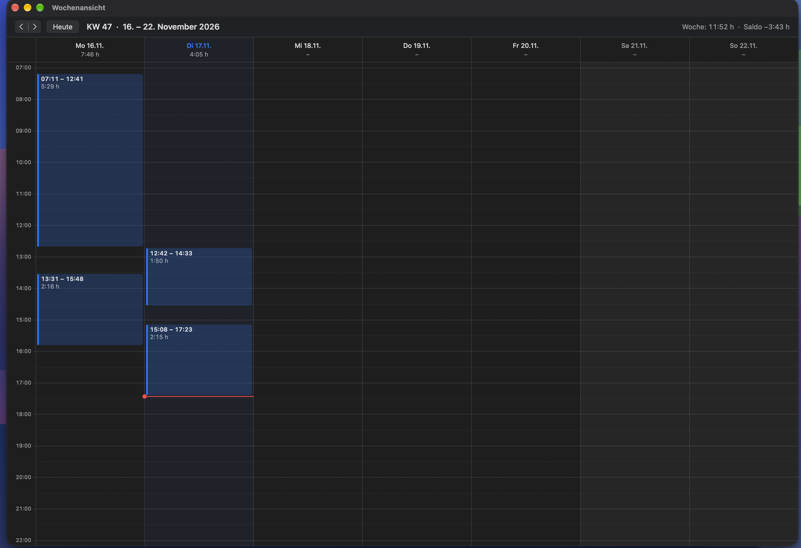
<br><br>
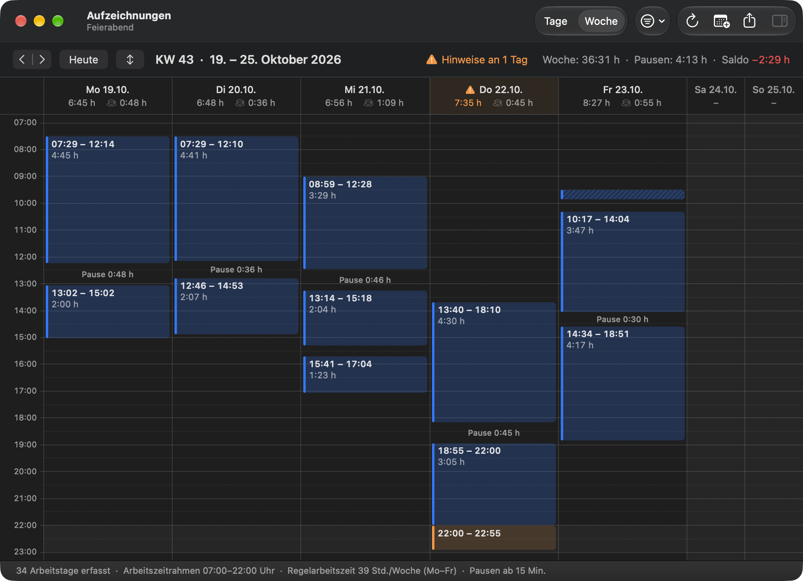
</details>

### Einstellungen

<table>
  <tr>
    <td align="center">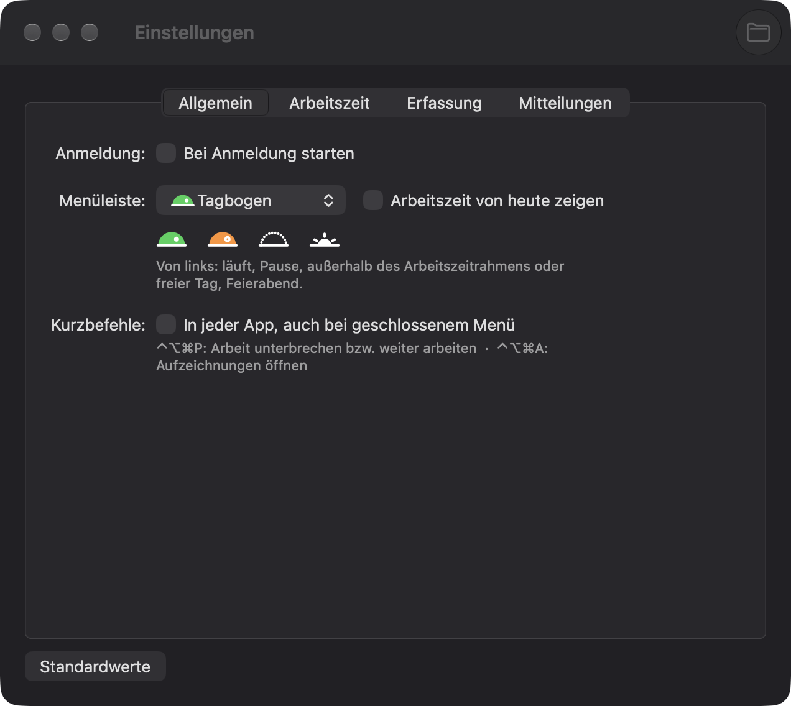<br><sub><b>Allgemein</b></sub></td>
    <td align="center">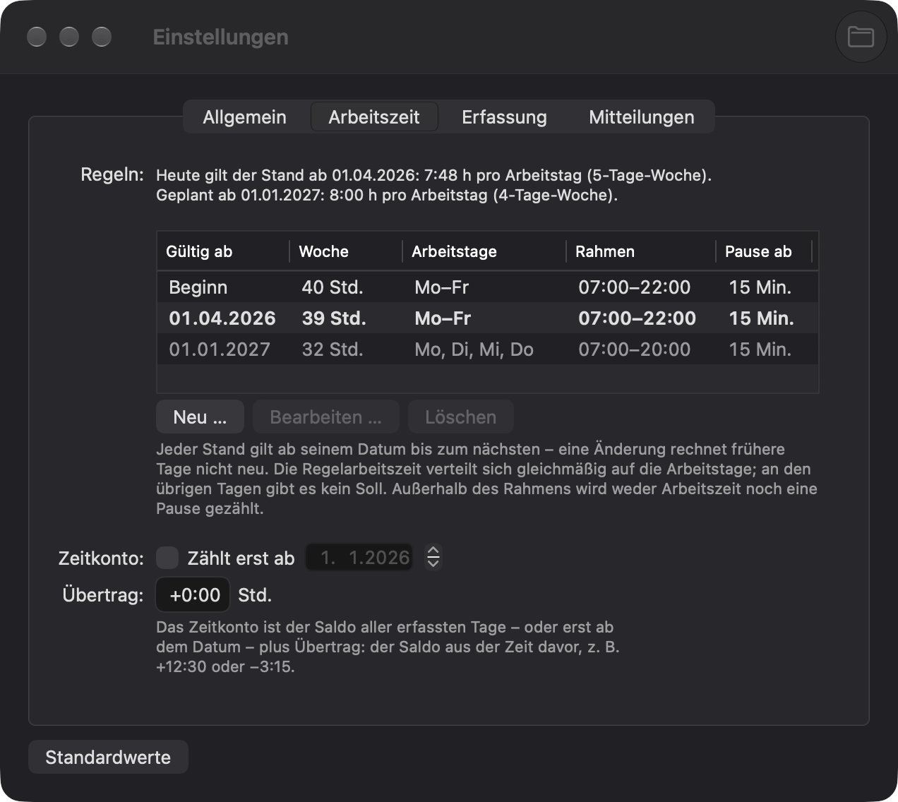<br><sub><b>Arbeitszeit</b></sub></td>
  </tr>
  <tr>
    <td align="center">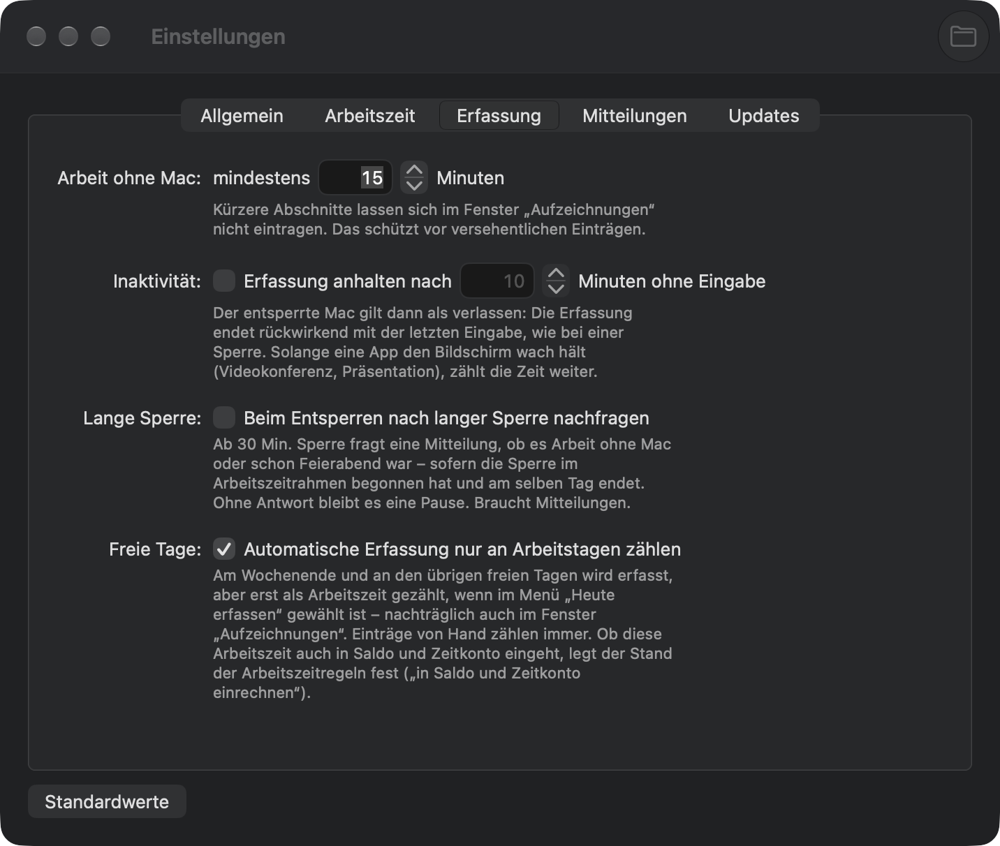<br><sub><b>Erfassung</b></sub></td>
    <td align="center">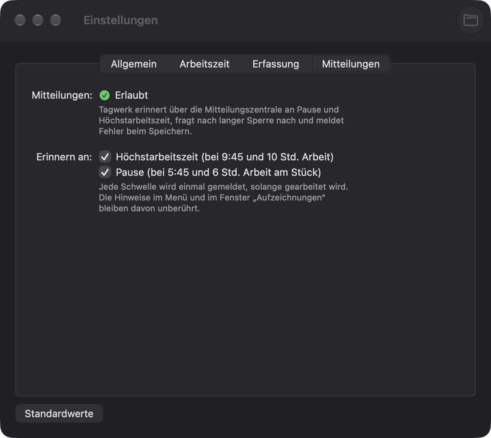<br><sub><b>Mitteilungen</b></sub></td>
  </tr>
</table>

Erreichbar über „Einstellungen …“ in der Menüleiste oder ⌘, im Fenster „Aufzeichnungen“.
Änderungen gelten sofort – bis auf die **Arbeitszeitregeln** (Regelarbeitszeit,
Arbeitstage, Arbeitszeitrahmen, Mindestpause): Sie gelten ab einem Datum, damit eine
Änderung bereits erfasste Tage nicht neu rechnet (siehe unten). Der Ordner-Knopf in der
Titelleiste zeigt den Datenordner im Finder. **Standardwerte** setzt alle Einstellungen
auf allen Reitern zurück, auch Zeitkonto und Übertrag; die Arbeitszeitregeln gelten ab
heute wieder wie zu Beginn, frühere Tage behalten ihre Stände, geplante entfallen. Nur
„Bei Anmeldung starten“ bleibt, wie es ist. Vorher fragt ein Dialog nach und nennt, was
zurückgesetzt wird und was bleibt.

Die Einstellungen stehen auf vier Reitern:

| Reiter       | Einstellung            | Bedeutung                                                               | Standard        |
|--------------|------------------------|-------------------------------------------------------------------------|-----------------|
| Allgemein    | Bei Anmeldung starten  | Tagwerk als Anmeldeobjekt eintragen (nur in der installierten App)      | ein             |
|              | Menüleiste             | Symbolsatz für die Menüleiste, mit Vorschau aller Zustände              | Tagbogen        |
|              | Arbeitszeit von heute zeigen | Arbeitszeit von heute neben dem Symbol in der Menüleiste          | aus             |
|              | Kurzbefehle            | ⌃⌥⌘P und ⌃⌥⌘A wirken in jeder App, auch bei geschlossenem Menü           | aus             |
|              | Datenschutz            | Datenbank und Backups verschlüsseln (siehe [Verschlüsselung](#verschluesselung)); „Wiederherstellungsschlüssel …“ zeigt den Schlüssel zum Aufbewahren | aus |
| Arbeitszeit  | Regeln (je Stand, gültig ab einem Datum): | | |
|              | – Regelarbeitszeit     | Wochenarbeitszeit, daraus ergibt sich das Tagessoll                      | 39 Std.         |
|              | – Arbeitstage          | Mo bis Fr einzeln wählbar; das Wochensoll verteilt sich gleichmäßig auf sie (angezeigt als „4-Tage-Woche · 9:45 Std. pro Arbeitstag“, bei ungeraden Wochenarbeitszeiten „9:37 bis 9:38 Std.“) | Mo–Fr |
|              | – Arbeitszeitrahmen    | Nur in diesem Zeitraum wird Arbeitszeit bzw. Pause gezählt – an jedem Tag; als Uhrzeiten einzutippen, bis Mitternacht: 24:00 | 07:00–22:00 Uhr |
|              | – Mindestpause         | Ab dieser Sperrdauer gilt eine Unterbrechung als Pause                  | 15 Min.         |
|              | – Freie Tage           | „Arbeit an freien Tagen in Saldo und Zeitkonto einrechnen“: Arbeit am Wochenende und an abgewählten Arbeitstagen geht als Mehrarbeit in Saldo und Zeitkonto ein | aus |
|              | Zeitkonto              | Zählt alle erfassten Tage oder erst ab einem Datum; der Übertrag ist der Saldo aus der Zeit davor (z. B. `+12:30`) | alle Tage, kein Übertrag |
| Erfassung    | Arbeit ohne Mac        | „mindestens … Minuten“ (1 bis 240): kürzere Abschnitte lassen sich im Fenster „Aufzeichnungen“ nicht eintragen | 15 Min. |
|              | Inaktivität            | Erfassung anhalten nach so vielen Minuten ohne Eingabe                  | aus (10 Min.)   |
|              | Lange Sperre           | Beim Entsperren nach mindestens 30 Min. Sperre nachfragen (nie kürzer als die Mindestpause); nur für Sperren, die im Arbeitszeitrahmen begonnen haben und am selben Tag enden | aus |
|              | Freie Tage             | Automatische Erfassung nur an Arbeitstagen als Arbeitszeit zählen; am Wochenende und an abgewählten Arbeitstagen erst nach „Heute erfassen“ | ein |
| Mitteilungen | Mitteilungen           | Zeigt, ob Tagwerk Mitteilungen senden darf; wenn nicht, öffnet „Systemeinstellungen öffnen“ die Mitteilungseinstellungen von Tagwerk | – |
|              | Erinnern an            | Höchstarbeitszeit (9:45 und 10 Std.) und Pause (5:45 und 6 Std. am Stück), einzeln abschaltbar | beides ein |

- **Allgemein** – unter der Auswahl des Symbolsatzes stehen seine vier Zustände als
  Vorschau: läuft, Pause, außerhalb des Arbeitszeitrahmens oder freier Tag, Feierabend.
- **Arbeitszeit** – die Arbeitszeitregeln stehen als Liste von Ständen: Jeder gilt ab
  seinem Datum bis zum nächsten, der erste seit Beginn. Für jeden Tag rechnet Tagwerk mit
  dem Stand, der an ihm galt – Soll, Saldo, Zeitkonto, Pausen, Hinweise, Wochenansicht und
  Export. Wer ab Dezember in Teilzeit geht, legt einen neuen Stand ab dem 1.12. an; die
  Monate davor bleiben, wie sie waren. Über der Liste steht, welcher Stand heute gilt und
  welcher als nächster geplant ist, jeweils mit dem Tagessoll; der heute gültige ist in der
  Liste fett, geplante sind grau. An freien Tagen – dem Wochenende und abgewählten
  Arbeitstagen – gibt es kein Soll. Arbeit dort wird angezeigt, wirkt sich aber
  standardmäßig nicht auf Saldo und Zeitkonto aus; mit „Arbeit an freien Tagen in Saldo
  und Zeitkonto einrechnen“ im Stand geht sie als Mehrarbeit ein (Spalte „Freie Tage“: „im
  Saldo“). Das ist etwas anderes als „Heute erfassen“: Jenes entscheidet, ob die an einem
  freien Tag erfasste Zeit überhaupt als Arbeitszeit zählt – dieser Schalter, ob solche
  Arbeitszeit auch den Saldo ändert. Tage, an denen sie nicht eingeht, haben in Tabelle,
  Inspektor und Export keinen Saldo („–“, in CSV ein leeres Feld). Die Fußzeile im
  Fenster „Aufzeichnungen“ nennt die Regeln des gewählten Tages („Regeln am 13.11.2026: …“),
  ohne Auswahl die von heute. Das Zeitkonto zählt ohne Haken alle erfassten Tage, mit Haken erst ab dem Datum; der Übertrag wird mit
  Vorzeichen eingegeben (`+12:30`, `−3:15`).

  **Neu …** öffnet das Blatt „Arbeitszeit ändern“ mit heute als „Gültig ab“ und den Regeln,
  die heute gelten; **Bearbeiten …** (oder Doppelklick) ändert den gewählten Stand samt
  Datum, beim ersten Stand nur die Regeln. Gespeichert wird erst mit „Übernehmen“. Unter
  dem Datum steht, bis wann der Stand gilt und für welche Tage danach andere Regeln gelten
  als bisher – auch beim Verschieben eines Stands, wo alle Tage zwischen altem und neuem
  Datum betroffen sind; orange, wenn er rückwirkend Saldo und Aufzeichnungen ändert oder
  einen vorhandenen Stand am selben Tag ersetzt. Ein Stand, der
  dem davor gleicht, entfällt von selbst. **Löschen** fragt nach; ab dem Datum gilt dann
  wieder der Stand davor. Der erste Stand lässt sich nicht löschen.

  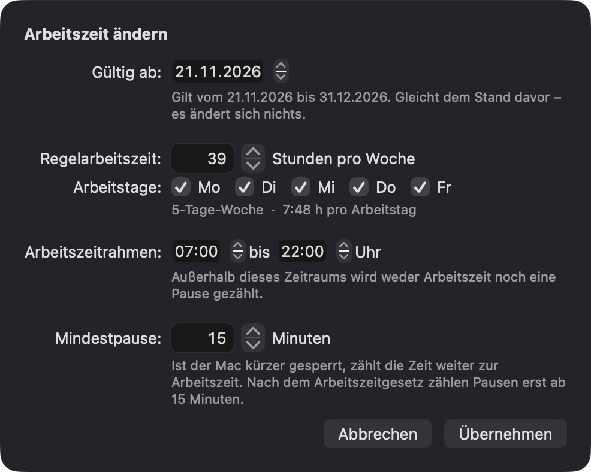
- **Erfassung** – die Mindestdauer für Arbeit ohne Mac schützt vor versehentlichen
  Einträgen und hängt nicht an der Mindestpause (die zu den Arbeitszeitregeln gehört): Auch ein Telefonat von zehn Minuten in
  einer langen Mittagspause oder vor dem Arbeitsbeginn lässt sich eintragen, wenn der Wert
  entsprechend gesenkt ist. Sie gilt für Einträge von Hand im Inspektor und in der
  Wochenansicht, nicht für „Ohne Mac weiterarbeiten“ im Menü. Die Minuten für die Inaktivität lassen sich
  erst einstellen, wenn die Erkennung eingeschaltet ist. Die Nachfrage nach langer Sperre
  braucht Mitteilungen. „Freie Tage“ entscheidet beim ersten Entsperren eines Tages und
  merkt sich das am Tag: Vergangene Tage ändern sich durch die Einstellung nicht – auch
  nicht, wenn man später andere Arbeitstage wählt. Einträge von Hand zählen immer.
- **Mitteilungen** – oben steht, ob macOS Mitteilungen von Tagwerk zulässt (erlaubt, nicht
  erlaubt, ausgeblendet oder nur in der installierten App). Die beiden Schalter gelten nur
  für die Erinnerungen; die Hinweise im Menü und im Fenster „Aufzeichnungen“ bleiben.

Neun Symbolsätze stehen zur Wahl. Sie werden von der App selbst gezeichnet und sind
damit in jeder Höhe scharf:

- **Tagbogen** – der Arbeitstag als Sonnenbogen, Feierabend als Sonnenuntergang
- **Schlossuhr** – offenes Schloss = Arbeitszeit, geschlossen = Pause
- **Tagesring** – Fortschritt zum Tagessoll
- **Bauarbeiter** und **Handwerkerin** – mit Hammer bzw. Schraubenschlüssel bei der
  Arbeit, mit Kaffee in der Pause, winkend zum Feierabend
- **Kaffeetasse** mit Gesicht, **Hamsterrad**, **Roboter** und **Kaninchen** (in der
  Pause knickt ein Ohr um)

### Export und Import

Über „Exportieren …“ im Fenster „Aufzeichnungen“ (Symbolleiste oder Menü „Ablage“, ⌘E)
wird ein frei wählbarer Zeitraum gespeichert – vorbelegt sind die letzten vier Wochen,
„Dieser Monat“ und „Letzter Monat“ sind einen Klick entfernt. Drei Formate stehen zur
Wahl:

- **Markdown** – vollständig, lässt sich wieder einlesen (siehe unten),
- **CSV** – die Übersicht als Tabelle für Excel oder Numbers: je Tag eine Zeile mit Datum,
  Wochentag, Beginn, Ende, Arbeitszeit (auch als Dezimalstunden), Pausen, Soll, Saldo,
  Abwesenheit, „Korrigiert“ und Hinweisen; Semikolon als Trenner, Dezimalkomma,
- **PDF** – die Übersicht zum Drucken auf A4, mit Wochensummen, Gesamtsumme und der Liste
  der Hinweise.

CSV und PDF zeigen Arbeitszeit und Pausen wie das Fenster (nach den angezeigten
Uhrzeiten). Der Saldo ist in allen drei Formaten derselbe wie im Fenster. Ein Tag ohne
Saldo (Arbeit an einem freien Tag, die nicht zählt) hat in Markdown und PDF „–“, in CSV
ein leeres Feld. Die Markdown-Datei enthält:

1. eine **Übersichtstabelle** mit Beginn, Ende, Arbeits- und Pausenzeit (sekundengenau)
   sowie Saldo je Tag (wie im Fenster nach den angezeigten Minuten) und einer Summenzeile,
2. **`## Hinweise`** – Verstöße gegen die [Regeln](#regeln),
3. **`## Korrekturen`** – die manuellen Entscheidungen samt Arbeit ohne Mac mit Notiz und
   Abwesenheiten,
4. **`## Erfasste Perioden`** – die automatisch erfassten Zeiten.

Ein Markdown-Export lässt sich wieder einlesen: im Fenster „Aufzeichnungen“ über Ablage ›
„Importieren …“ (⇧⌘I) oder mit `Tagwerk --import <datei.md>`. Die enthaltenen Tage
ersetzen dabei die vorhandenen Einträge dieser Tage; das Fenster nennt vorher, wie viele
Tage betroffen sind. Vor dem Import sichert Tagwerk den Stand eigens im Ordner `backups`
(`tagwerk-JJJJ-MM-TT-vor-import-HHMMSS.db`) – damit lässt er sich zurückholen. Tage, die
auch das Fenster nicht zuließe, werden übersprungen und genannt: Zeiten in der Zukunft,
ein Arbeitsbeginn, der nicht vor dem Feierabend liegt, eine ganztägige Abwesenheit neben
anderen Einträgen. CSV und PDF lassen sich nicht einlesen – ihnen fehlen die erfassten
Perioden.

## Regeln

Tagwerk wendet die folgenden Regeln an. Sie stammen teils aus dem Arbeitszeitgesetz
(ArbZG), teils aus einer fiktiven Betriebsvereinbarung. Verstöße zeigt Tagwerk in der
Menüleiste, in der Tabelle, im Inspektor, in der Wochenansicht und im Export an. Die
erfasste Arbeitszeit ändern sie nicht.

| Regel                | Inhalt                                                                  |
|----------------------|-------------------------------------------------------------------------|
| Arbeitszeitrahmen    | Zeit außerhalb des eingestellten Zeitraums wird nicht gezählt; Arbeit am Wochenende und an abgewählten Arbeitstagen wird gemeldet und zählt nur als Mehrarbeit, wenn der Stand der Arbeitszeitregeln es vorsieht |
| Sollarbeitszeit      | Regelwochenarbeitszeit, gleichmäßig auf die eingestellten Arbeitstage verteilt (39 Std. an Mo–Fr → 7:48 Std.), je Tag in ganzen Minuten (38,5 Std. an vier Tagen → 9:37, 9:38, 9:37 und 9:38 Std.) |
| Pausen (§ 4 ArbZG)   | mehr als 6 Std. Arbeit: 30 Min., mehr als 9 Std.: 45 Min.; höchstens 6 Std. am Stück ohne Pause; es zählen Pausen ab 15 Min. |
| Ruhezeit (§ 5 ArbZG) | mindestens 11 Std. zwischen dem Ende eines Arbeitstags und dem nächsten Beginn |
| Höchstarbeitszeit    | mehr als 10 Std. Arbeit an einem Tag; Mitteilung bei 9:45 und 10 Std. (abschaltbar) |
| Erfassung            | Beginn und Ende durch Entsperren/Sperren, Arbeit unterbrechen/Weiter arbeiten oder Ohne Mac weiterarbeiten; keine Zeiten in der Zukunft (Abwesenheiten schon) |

Pausen, Ruhezeit und Höchstarbeitszeit prüft Tagwerk zuerst mit der gezählten Arbeitszeit
und dann mit der tatsächlichen – samt der Zeit außerhalb des Arbeitszeitrahmens, denn das
Gesetz fragt nicht danach, was gezählt wird. Ergibt sich der Verstoß erst so, sagt der
Hinweis es dazu („Ruhezeit nur 9:45 Std. – vorgeschrieben sind 11 Std. (§ 5 ArbZG), mit der
Zeit außerhalb des Arbeitszeitrahmens“). Außen vor bleiben Abschnitte unter einer Minute,
die Zeit nach dem Feierabend und was an einem freien Tag erfasst, aber nicht gezählt ist.

> [!NOTE]
> Der Saldo vergleicht die Arbeitszeit mit dem Soll. Jeder Arbeitstag bis gestern zählt
> sein Soll – auch ganz ohne Eintrag, ab dem ersten erfassten Tag. Urlaub, Feiertage und
> Krankheit trägt man deshalb als Abwesenheit ein; sie regelt das Soll des Tages (halber
> Urlaubstag: die Hälfte, Sonderurlaub: null, Zeitausgleich: voll). Heute zählt das Soll
> nur, soweit es schon erarbeitet ist: Der laufende Tag steht bei +0:00, bis das Soll
> erreicht ist, und danach im Plus – Wochensaldo und Zeitkonto fallen also nicht morgens um
> das Tagessoll. Was fehlt, zählt mit dem Feierabend oder ab morgen; Zeitausgleich zählt
> sofort. Künftige Tage (eine geplante Abwesenheit) zählen noch gar nicht. Jeder Tagessaldo
> ist eine ganze Minutenzahl, Tage summieren sich also ohne Rundungsreste zur Woche. Arbeit am Wochenende und an abgewählten Arbeitstagen geht standardmäßig nicht in
> den Saldo ein; mit „Arbeit an freien Tagen in Saldo und Zeitkonto einrechnen“ im Stand
> der Arbeitszeitregeln zählt sie vollständig als Mehrarbeit – automatisch erfasste Zeit dort
> erst nach „Heute erfassen“ (Einstellung „Freie Tage“ unter „Erfassung“).
> Das Zeitkonto ist dieser Saldo über alle Tage (oder ab einem Datum) plus Übertrag.

## Installation

### Voraussetzungen

- macOS 13 (Ventura) oder neuer, Apple Silicon (arm64)
- Zum Bauen: [Rust](https://rustup.rs) und die Xcode-Befehlszeilenwerkzeuge
  (`xcode-select --install`)

### Aus dem Quellcode bauen

```bash
git clone https://github.com/rfoerthe/tagwerk.git
cd tagwerk
./build.sh --no-sign --install
```

Damit wird Tagwerk gebaut, ad hoc signiert und nach `/Applications` kopiert. Zum
schnellen Ausprobieren während der Entwicklung genügt `cargo run`.

### App-Bundle und DMG

`build.sh` erzeugt ein fertiges App-Bundle samt DMG:

```bash
./build.sh                 # sauber bauen, signieren und notarisieren
./build.sh --no-notarize   # nur bauen und signieren
./build.sh --no-sign       # nur bauen (ad-hoc signiert, nur für diesen Mac)
./build.sh --install       # zusätzlich nach /Applications installieren
```

`--install` lässt sich mit den anderen Optionen kombinieren. Läuft Tagwerk bereits aus
`/Applications`, wird es vorher regulär beendet – die laufende Erfassung wird dabei
gespeichert – und nach dem Kopieren wieder gestartet.

Das Ergebnis liegt in `target/dist/Tagwerk-<Version>.dmg`. Das Skript führt vorher
`cargo clean` aus; ältere DMGs in `target/dist` werden dabei gelöscht.

Geöffnet zeigt das DMG auf hellem Hintergrund das App-Symbol, einen Pfeil und den Ordner
„Programme“. Den Hintergrund zeichnet `tools/MakeDMGBackground.swift` (braucht `swift`
aus den Xcode Command Line Tools), das Fenster richtet der Finder per AppleScript ein.
Beim ersten Build fragt macOS deshalb, ob das Terminal den Finder steuern darf; ohne
diese Erlaubnis entsteht ein gültiges, aber ungestaltetes DMG. Ein bereits eingehängtes
Volume „Tagwerk“ muss vor dem Build ausgeworfen sein.

<details>
<summary>Signieren und Notarisieren</summary>
<br>

| Variable         | Bedeutung                                   | Standard                       |
|------------------|---------------------------------------------|--------------------------------|
| `SIGN_IDENTITY`  | Zertifikat „Developer ID Application: …“    | erste gefundene Developer-ID   |
| `NOTARY_PROFILE` | Schlüsselbund-Profil für `notarytool`       | `general-notary`               |
| `BUNDLE_ID`      | Bundle-Kennung                              | `de.foerther.tagwerk`          |

`build.sh` notarisiert zuerst die App und heftet ihr das Ticket an, damit sie nach dem
Kopieren auch ohne Internetverbindung startet. Danach packt es die App ins DMG und
notarisiert auch das DMG – pro Build gibt es also zwei Einreichungen bei Apple. Beide
müssen Gatekeeper als „Notarized Developer ID“ bestehen, sonst bricht das Skript ab.

Das Notary-Profil wird einmalig angelegt mit:

```bash
xcrun notarytool store-credentials general-notary --apple-id <apple-id> --team-id <team-id>
```

</details>

### Release auf GitHub

Nach `./build.sh` veröffentlicht `github-release.sh` das DMG als Release auf GitHub:

```bash
./github-release.sh --dry-run   # nur prüfen und anzeigen, was passieren würde
./github-release.sh             # Tag v<Version> setzen und Release veröffentlichen
```

Das Skript prüft Prüfsumme (`Tagwerk-<Version>.dmg.sha256` von `build.sh`), Signatur und
Notarisierung, gleicht die Version mit `Cargo.toml` ab und übernimmt die Release-Notizen
aus dem passenden Eintrag in [CHANGELOG.md](CHANGELOG.md). Voraussetzung ist die
[GitHub CLI](https://cli.github.com) (`brew install gh`, `gh auth login`); der Commit
muss bereits gepusht sein.

## Kommandozeile

```text
Tagwerk                       Menüleisten-App (Standard)
Tagwerk --records             nur das Fenster „Aufzeichnungen“ öffnen
Tagwerk --export [--from TT.MM.JJJJ] [--to TT.MM.JJJJ] [--format md|csv|pdf] [-o datei]
                              Aufzeichnungen exportieren: Markdown, CSV oder PDF.
                              Ohne --format entscheidet die Endung von -o, sonst Markdown.
                              (Standard: die letzten 28 Tage, Ausgabe auf stdout;
                              PDF nur mit -o)
Tagwerk --import <datei.md>   Tage aus einem Markdown-Export übernehmen
Tagwerk --screenshot <png>    Fenster „Aufzeichnungen“ als Bild speichern und beenden
Tagwerk --week-screenshot <png>
                              Fenster „Aufzeichnungen“ in der Ansicht „Woche“ als Bild
                              speichern und beenden
Tagwerk --settings-screenshot <png>
                              Fenster „Einstellungen“ als Bild speichern und beenden
Tagwerk --menu-screenshot <png>
                              Menü der Menüleiste öffnen, als Bild speichern und beenden
```

Es läuft immer nur eine Instanz der Menüleisten-App.

## Daten

> **Kurz gesagt:** Alle Aufzeichnungen bleiben bei dir. Tagwerk speichert sie in deinem
> Benutzerordner auf dem Mac – kein Konto, kein Server, keine Cloud-Synchronisation, keine
> Übertragung ins Netz. Die Datenbank und ihre Backups lassen sich auf Wunsch
> [verschlüsseln](#verschluesselung).

Datenbank und Backups liegen zusammen im Datenordner deines Benutzerkontos:

```text
~/Library/Application Support/Tagwerk/
├── tagwerk.db                     Datenbank (SQLite)
└── backups/
    └── tagwerk-JJJJ-MM-TT.db      tägliche Backups, die letzten 15
```

Die Datenbank enthält die automatisch erfassten Perioden (Mac entsperrt), getrennt davon die
manuellen Korrekturen (Arbeitsbeginn, Pausen, Arbeit ohne Mac, Feierabend, Abwesenheiten,
„Heute erfassen“ an freien Tagen) sowie die Einstellungen. Die
Perioden werden ungekürzt gespeichert; Mindestpause und Arbeitszeitrahmen wirken erst
bei der Berechnung. Bearbeitet werden die Daten im Fenster „Aufzeichnungen“; Änderungen
dort übernimmt die laufende App automatisch.

### Backups

Vor der ersten Änderung eines Tages wird die Datenbank unter
`backups/tagwerk-JJJJ-MM-TT.db` gesichert; die letzten 15 Backups bleiben erhalten. Auch
die Backups bleiben im Datenordner auf dem Mac.

<a id="verschluesselung"></a>

### Verschlüsselung (optional)

Standardmäßig ist die Datenbank nicht verschlüsselt; sie ist dann wie alle Dateien im
Benutzerordner durch die Rechte des Benutzerkontos und gegebenenfalls FileVault geschützt.
„Datenbank und Backups verschlüsseln“ in den
Einstellungen (Reiter „Allgemein“) verschlüsselt `tagwerk.db` und alle Backups mit
[SQLCipher](https://www.zetetic.net/sqlcipher/) (AES-256). Der Schlüssel ist zufällig und
liegt im Schlüsselbund von macOS (Eintrag „Tagwerk – Schlüssel der Datenbank“), daher
startet Tagwerk weiter ohne Passwort. Andere Programme fragen erst nach, bevor sie ihn
lesen dürfen. Vor dem Einschalten zeigt Tagwerk den **Wiederherstellungsschlüssel**
(64 Zeichen, auch später unter „Wiederherstellungsschlüssel …“). Fehlt der Eintrag im
Schlüsselbund, etwa auf einem neuen Mac, fragt Tagwerk beim Start nach ihm. Ohne beides
sind die Aufzeichnungen verloren. Entfernt man den Haken wieder, schreibt Tagwerk
Datenbank und Backups unverschlüsselt zurück und löscht den Schlüssel.

Zum Umstellen startet Tagwerk neu: SQLCipher kann eine Datei nicht an Ort und Stelle ver-
oder entschlüsseln. Tagwerk schreibt deshalb vor dem ersten Öffnen eine neue Datei, prüft
sie und ersetzt damit die alte. Dabei darf kein anderes Programm die Datenbank geöffnet
haben (etwa `Tagwerk --records` oder ein Export im Terminal), sonst bleibt alles, wie es
war. Gut zu wissen:

- Ältere Tagwerk-Versionen (bis 1.7) und `sqlite3` können eine verschlüsselte Datenbank
  nicht öffnen. Vor einem Wechsel zurück die Verschlüsselung ausschalten.
- Exporte (Markdown, CSV, PDF) sind nicht verschlüsselt.
- Was vorher unverschlüsselt war, kann noch in Time-Machine-Backups stehen. Auch die
  ersetzte Datei ist auf der SSD nicht sicher gelöscht.
- Die Markdown-Dateien früherer Versionen (`tagwerk.md.importiert`, `backups/*.md`)
  bleiben, wie sie sind; Tagwerk nennt sie nach dem Verschlüsseln.

<details>
<summary>Verfahren und Standards</summary>

Tagwerk verschlüsselt nicht selbst, sondern nutzt [SQLCipher](https://www.zetetic.net/sqlcipher/design/)
4.20 (über `rusqlite` mit `bundled-sqlcipher`) mit dessen Standardeinstellungen für
SQLCipher 4; eigene `cipher_*`-Einstellungen setzt Tagwerk nicht. Die Kryptografie
selbst kommt auf macOS aus CommonCrypto (Apple corecrypto), nicht aus OpenSSL.

| Baustein                 | Verfahren                                                                                       | Standard                                   |
|--------------------------|-------------------------------------------------------------------------------------------------|--------------------------------------------|
| Schlüssel                | 256 Bit aus dem Zufallsgenerator von macOS (`SecRandomCopyBytes`)                               | –                                          |
| Verschlüsselung          | AES-256 im CBC-Modus, jede Seite (4096 Byte) mit eigenem zufälligem 16-Byte-IV                  | FIPS 197 (AES), NIST SP 800-38A (CBC)      |
| Integrität               | HMAC-SHA512 je Seite über Geheimtext, IV und Seitennummer (Encrypt-then-MAC)                    | FIPS 198-1 / RFC 2104 (HMAC), FIPS 180-4 (SHA-512) |
| Schlüsselableitung       | keine für den AES-Schlüssel: Tagwerk übergibt ihn roh (`PRAGMA key = "x'…'"`). Den HMAC-Schlüssel leitet SQLCipher daraus mit PBKDF2-HMAC-SHA512 (2 Runden, eigenes Salz) ab | RFC 8018 / NIST SP 800-132 (PBKDF2) |
| Salz                     | 16 Zufallsbytes am Anfang der Datei; der übrige Dateikopf ist mit verschlüsselt                 | –                                          |
| Aufbewahrung             | generischer Kennworteintrag im Schlüsselbund von macOS (Dienst `de.foerther.tagwerk`)           | –                                          |

Die 256 000 PBKDF2-Runden, die SQLCipher für Passwörter vorsieht, fallen weg: Ein
zufälliger 256-Bit-Schlüssel lässt sich ohnehin nicht erraten, eine langsame Ableitung
brächte nichts. Der Wiederherstellungsschlüssel ist derselbe Schlüssel in Hex-Schreibweise.

Verschlüsselt sind alle Seiten der Datenbank, auch WAL und Backups. Eine veränderte oder
beschädigte Seite fällt beim Lesen am HMAC auf. Nicht geschützt ist, was außerhalb der
Datenbank liegt (Exporte, siehe oben) und was im Speicher der laufenden App steht; Tagwerk
überschreibt seine Kopie des Schlüssels beim Freigeben mit Nullen. Tagwerk selbst ist
nicht nach FIPS 140 oder anderen Normen zertifiziert.

</details>

### Ältere Versionen

Die Markdown-Datei `tagwerk.md` früherer Versionen wird beim
ersten Start einmalig in die Datenbank übernommen und danach in `tagwerk.md.importiert`
umbenannt. Ab Version 1.2.0 nutzt die Datenbank Schema 3; Tagwerk 1.1 und älter können
sie danach nicht mehr öffnen – zurück geht es nur mit einem Backup aus `backups/` von
einem Tag vor dem Update. Die Abwesenheiten liegen in einer eigenen Tabelle ohne neue
Schema-Version: Ältere Versionen ab 1.2.0 öffnen die Datenbank weiter, kennen die
Abwesenheiten nur nicht und rechnen das Soll ohne sie. Ebenso die Entscheidung „Heute
erfassen“ an freien Tagen: Ältere Versionen zählen dort alle erfasste Zeit.

## Entwicklung

```bash
cargo run     # App starten
cargo test    # Tests ausführen
```

Zum Testen lässt sich der Datenordner mit der Umgebungsvariablen `TAGWERK_DIR`
umlenken:

```bash
TAGWERK_DIR=/tmp/tagwerk-test cargo run
```

Mit `TAGWERK_DIR` hat eine verschlüsselte Testdatenbank einen eigenen Eintrag im
Schlüsselbund (mit dem Pfad im Namen). Bei jedem neuen Debug-Build fragt macOS, ob er ihn
lesen darf: Die ad-hoc-Signatur ändert sich mit jedem Build. Den Test gegen den echten
Schlüsselbund startet `cargo test -- --ignored keychain`.

Das App-Symbol liegt als `assets/AppIcon.png` (1024 × 1024) im Projekt, die Vorlage
dazu als `assets/AppIcon.svg`; `build.sh` erzeugt daraus `AppIcon.icns`. Die Symbole der
Menüleiste zeichnet die App selbst (`src/glyphs.rs`).

<details>
<summary>Testdaten</summary>
<br>

`testdata/testdb.sh` erzeugt eine Testdatenbank, die immer bis gestern reicht: 18 volle
Kalendermonate plus die Tage des laufenden Monats, Wochensummen um 39 Stunden ± 8 %.
Kein Werktag bleibt ohne Eintrag: Die bundesweiten Feiertage sind als „Feiertag“
eingetragen, dazu 30 Urlaubstage im Jahr (Karwoche, Brückentag nach Himmelfahrt, zwei bis
drei Wochen im Sommer, eine Herbstwoche, zwischen den Jahren, Heiligabend und Silvester als
halbe Tage, der Rest einzeln) und 6 Tage Zeitausgleich (zuerst Brückentage, sonst
Freitage). Die Mehrarbeit dafür ist über das Jahr verteilt, das Zeitkonto pendelt um null.
Alle sechs Monate gibt es einen Tag Sonderurlaub; am Samstag der Woche davor wird 4 bis 6
Stunden gearbeitet (mit „Heute erfassen“ – im Saldo zählt das nur, wenn die
Arbeitszeitregeln es vorsehen).
An rund 25 % der Tage gibt es Arbeit ohne Mac (Meeting,
Telefonat, Networking, Sonstiges – bei gesperrtem Mac, vor dem Beginn oder nach dem Ende,
auch Meeting und Telefonat direkt hintereinander als zwei Abschnitte), dazu alle sechs
Wochen dieselben Regelverstöße: zu kurze Ruhezeit, Arbeit vor 7 und nach 22 Uhr, zu wenig
Pause. An rund 10 % der Tage wird außerdem mehr als 6 Stunden ohne Pause durchgearbeitet.
Datenbank und Markdown-Quelle landen in `target/testdata/` und werden bei jedem Aufruf
neu erzeugt.

```bash
testdata/testdb.sh             # target/testdata/tagwerk.db neu bauen
testdata/testdb.sh --install   # zusätzlich als zentrale Datenbank einsetzen
testdata/testdb.sh --restore   # die echten Daten zurückholen
```

Mit `--install` wird die zentrale Datenbank vorher nach
`~/Library/Application Support/Tagwerk/vor-testdaten/` gesichert – außer sie enthält
schon Testdaten (die Testdatenbank ist dafür gekennzeichnet). `--restore` holt die
neueste Sicherung mit echten Daten zurück. Laufende Tagwerk-Instanzen werden dafür
beendet und – wenn sie als App liefen – danach neu gestartet. Ohne Austausch lässt sich
die Testdatenbank auch direkt öffnen:

```bash
TAGWERK_DIR=target/testdata cargo run -- --records
```

Für die Bilder des Menüs setzt `TAGWERK_MENU_STATE=break|away|closed` den Zustand und
`TAGWERK_NOW` eine feste Uhrzeit – so entsteht etwa das Bild vom freien Tag an einem
Samstag, egal wann es aufgenommen wird:

```bash
TAGWERK_DIR=/tmp/tagwerk-bild TAGWERK_NOW="2026-11-21 10:20" \
  cargo run -- --menu-screenshot doc/screenshots/menu-frei.png
```

</details>

## Lizenz

Tagwerk steht unter der [MIT-Lizenz](LICENSE).
